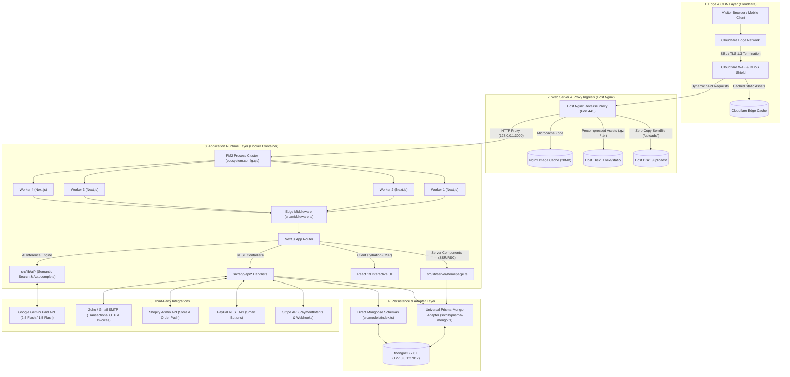
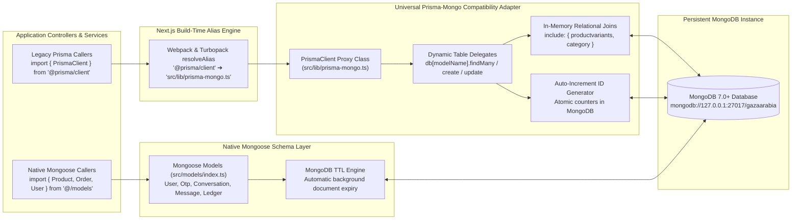
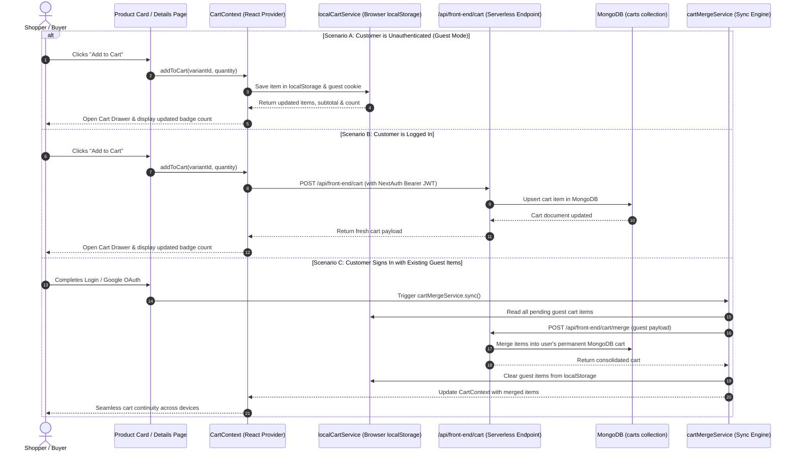
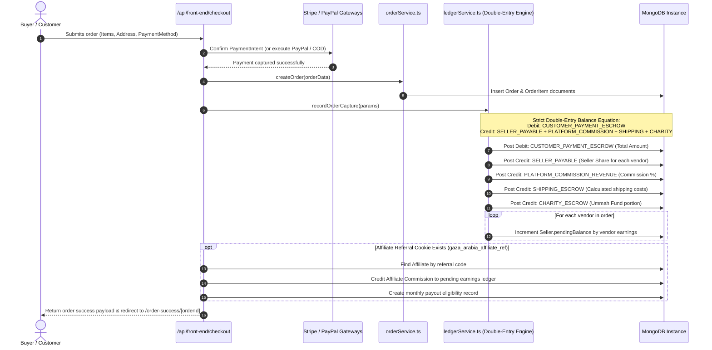
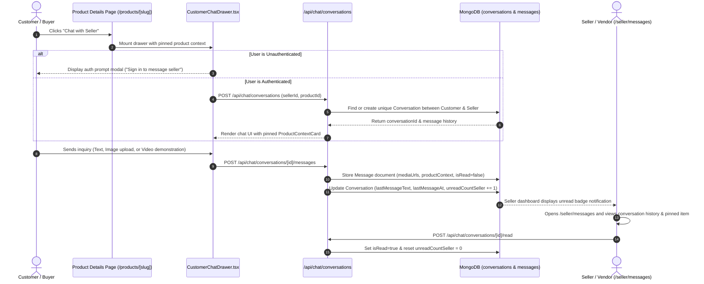
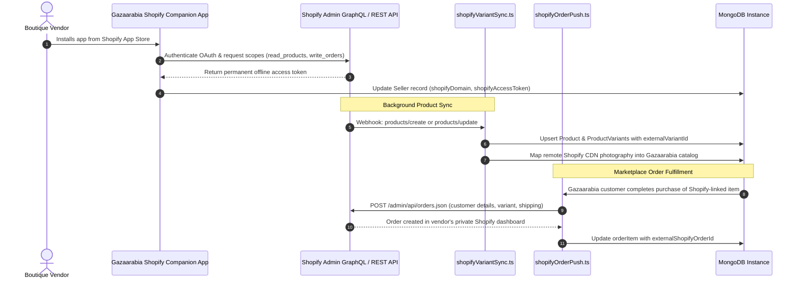
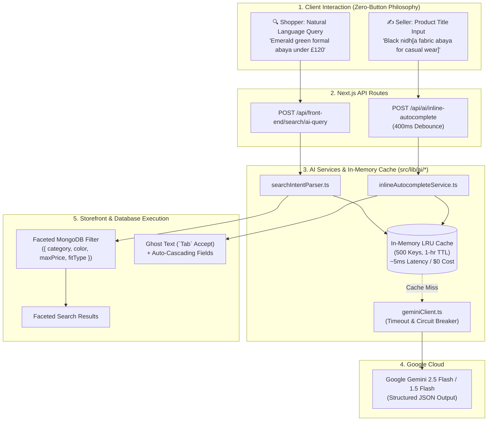

# GAZAARABIA — Multi-Vendor Marketplace System Architecture & Repository Blueprint (`Architecture.md`)

> **Master Technical Authority:** Comprehensive architectural specification, repository directory mapping, subsystem data flows, and production deployment blueprints for the **Gazaarabia** modest fashion e-commerce marketplace platform.
> **Runtime Environment:** Next.js 16.2.2 (App Router / Turbopack / React 19.1.0) | Node.js 20+ LTS | MongoDB 7.0+ (Mongoose 9.11 + Universal Prisma Adapter) | Docker & PM2 Cluster | Nginx 1.24 | Cloudflare CDN.

---

## 1. Executive Summary & Technology Stack

**Gazaarabia** is an enterprise-grade, multi-vendor modest wear and ethical fashion marketplace. The platform connects consumers with boutique modest wear designers and brands, provides unified checkout across multiple independent vendors, enforces double-entry escrow financial accounting, handles automated affiliate/ambassador commissions, enables real-time customer-to-seller messaging with pinned product context, and synchronizes inventory and orders with external e-commerce engines (Shopify).

### 1.1 Core Technology Stack & Architectural Decisions

| Architectural Layer | Selected Technology | Version / Spec | Engineering Rationale & Invariants |
| :--- | :--- | :--- | :--- |
| **Frontend Framework** | **Next.js (App Router)** | `^16.1.6` (`16.2.2`) | Server Components (RSC) for zero-JS initial payload, client hydration for interactive widgets, Incremental Static Regeneration (ISR). |
| **UI Library & Core** | **React** | `19.1.0` | React Server Components, Server Actions (`bodySizeLimit: "1024mb"`), transitions, and fine-grained hydration boundaries. |
| **Styling & Design Tokens** | **Tailwind CSS** | `^3.4.18` | Utility-first CSS, `@tailwindcss/line-clamp`, `tailwind-scrollbar`, Framer Motion micro-interactions, Emotion, and Radix UI primitives. |
| **Language System** | **TypeScript** | `^5.9.3` | Strict type assertions, Prisma/Mongo DTO schemas, and zero build-time type failure bypasses. |
| **Database & ODM** | **MongoDB & Mongoose** | `MongoDB 7.0+` / `Mongoose 9.11.4` | Native document store. High-performance collections with compound indexes, TTL self-cleaning indexes, and atomic `$inc` updates. |
| **Compatibility Layer** | **Universal Prisma Adapter** | Custom (`src/lib/prisma-mongo.ts`) | Intercepts `@prisma/client` imports via Webpack/Turbopack aliases and maps relational Prisma queries dynamically to MongoDB collections. |
| **Authentication & RBAC** | **NextAuth.js & JWT** | `^4.24.13` | Stateless JSON Web Tokens, Google OAuth 2.0 with forced account selection, and self-expiring 6-digit email OTPs. |
| **Financial Ledger** | **Double-Entry Ledger** | Custom (`src/lib/services/ledgerService.ts`) | Strict double-entry ledger ensuring `Total Debits == Total Credits` across customer escrow, vendor payables, commissions, and charity funds. |
| **Real-Time Messaging** | **Conversations Engine** | Custom (`src/app/api/chat/*`) | Real-time split-screen messaging, media previews, lightbox zoom, read receipts, and auto-attached product preview context. |
| **External Channel Sync** | **Shopify App Bridge** | Embedded Remix/Vite App (`shopify-app/`) | Bidirectional sync: imports vendor products from Shopify and automatically pushes marketplace orders back to Shopify seller stores. |
| **Image & Media Engine** | **Native Sharp & HTTP 206** | `sharp: ^0.35.5` | Native SIMD `libvips` WebP/AVIF transformations on-the-fly; HTTP 206 partial range streaming for high-resolution variant showcase videos. |
| **Hover-to-Play Video** | **Dynamic Range Video Preview** | Custom (`ProductCard.tsx` / `HTTP 206`) | Non-blocking video hover engine with `preload="metadata"`, zero layout shift, seamless looping previews, and graceful mobile fallback. |
| **AI Inference & Discovery** | **Google Gemini Paid API** | `@google/genai` (`gemini-2.5-flash`) | Alibaba-style conversational semantic search, visual search embeddings, in-memory LRU query cache, debounced inline ghost-text autocompletion (`Tab` accept) and auto-cascading product form fields. |
| **Payment Gateways** | **Stripe & PayPal** | Stripe API `^20.0.0` / PayPal SDK `^8.9.2` | Stripe Payment Intents with Saved Cards, PayPal Smart Buttons, and Cash on Delivery (COD) workflows. |
| **Process Management** | **PM2 Cluster** | Custom (`ecosystem.config.cjs`) | 4 Node.js worker instances in cluster mode with zero-downtime rolling reloads (`pm2 reload`). |
| **Containerization** | **Docker Compose** | Multi-stage `node:20-slim` | Production container deployed with `network_mode: "host"` and cgroup limits (6 CPU Cores, 6 GB RAM) for shared-VPS safety. |
| **Edge & Web Proxy** | **Nginx & Cloudflare** | Nginx 1.24+ / TLS 1.3 | Direct zero-copy kernel sendfile for `/uploads`, static asset gzip/brotli delivery, and Cloudflare Real-IP header restoration. |

---

## 2. Master Repository Directory Map

```text
Gazaarabia/
├── Architecture.md                   # [This Document] Definitive System Architecture & Repository Blueprint
├── Dockerfile                        # Multi-stage production container definition (Node 20 slim, Sharp, PM2)
├── docker-compose.yml                # Isolated container orchestration with cgroup resource allocations
├── ecosystem.config.cjs              # PM2 cluster configuration (4 API cluster workers + 1 Webhook daemon)
├── server.js                         # Custom HTTP server initializing Next.js with graceful SIGTERM/SIGINT shutdown
├── next.config.ts                    # Hardened Next.js configuration (Webpack alias, CSP, image remote patterns)
├── package.json                      # Dependency manifest and administrative npm script entrypoints
├── tsconfig.json                     # TypeScript compilation configuration with path aliases (@/* -> src/*)
│
├── Backup/                           # Disaster recovery & static media source (Strictly Read-Only)
│   ├── uploads/                      # Master asset archive (categories, products, variants)
│   └── uploads.zip                   # Compressed binary backup archive (~1 GB)
│
├── deploy/                           # Production web server & reverse proxy configurations
│   ├── nginx-gazaarabia.conf         # Production Nginx server block with SSL, HTTP/2, caching, and rate limits
│   ├── cloudflare-ips.conf           # Cloudflare trusted proxy IP CIDR ranges for real visitor IP restoration
│   └── install-nginx-tuning.sh       # Automated Linux kernel sysctl and worker connection performance tuner
│
├── docs/                             # Engineering documentation & architectural specifications
│   ├── HLD.md                        # [High-Level Design] Production scale, capacity math, NFR SLAs, diagrams
│   ├── LLD.md                        # [Low-Level Design] Object models, UML class diagrams, GoF patterns, concurrency
│   ├── PROJECT_ARCHITECTURE.md       # Architectural deep-dive and component guide
│   ├── AI_GEMINI_SEARCH_ARCHITECTURE_PLAN.md # Alibaba-style conversational semantic search blueprint
│   ├── AI_PRODUCT_AUTOCOMPLETE_PLAN.md       # Real-time inline ghost-text auto-complete specification
│   ├── CODEBASE_GUIDE.md             # Developer quickstart and onboarding workflows
│   ├── CLOUDFLARE_CDN_SETUP.md       # Edge caching rules, WAF configurations, and DNS proxy setup
│   └── concepts_brief.md             # EGM-compliant functional requirements brief
│
├── public/                           # Static assets served directly by the web server
│   ├── images/                       # Fixed marketplace branding (logos, trust icons, Palestine heritage badges)
│   ├── site.webmanifest              # Progressive Web App (PWA) manifest configuration
│   └── tinymce/                      # Self-hosted TinyMCE rich-text editor distribution (offline/cloudless)
│
├── scripts/                          # Administrative, database migration, and operations tooling
│   ├── backup-mongodb.sh             # Automated daily MongoDB backup script with 7-day snapshot retention
│   ├── catalog-seed-data.json        # Curated catalog blueprint: categories, subcategories, products, variants
│   ├── copy-tinymce.mjs              # Postinstall script copying TinyMCE assets into public/tinymce/
│   ├── deploy-webhook.sh             # Automated zero-downtime deployment script triggered via GitHub webhook
│   ├── ensure-indexes.ts             # Enforces performance, unique, compound, and TTL indexes across MongoDB
│   ├── migrate-sql-to-mongo.ts       # Legacy MySQL/Prisma relational schema migration pipeline to MongoDB
│   ├── optimize-convert-webp.mjs     # Batch asset optimization utility converting raw assets to modern WebP
│   ├── precompress-assets.mjs        # Postbuild script creating pre-compressed .gz and .br static assets
│   ├── seedAdmin.js                  # Idempotent super-admin credential seeder
│   ├── seed-fresh-products.ts        # Automated catalog seeder verifying disk images
│   ├── seedFromBackup.js             # Automated media restore and catalog seed engine
│   ├── test-auth-complete.ts         # Automated test suite for NextAuth, JWT, OTP, and session verification
│   ├── test-mongo-fullstack.ts       # Fullstack MongoDB connectivity, model audit, and healthcheck test
│   └── webhook-server.cjs            # Lightweight HMAC-verified GitHub deployment webhook listener (Port 9000)
│
├── shopify-app/                      # Standalone companion Shopify App for multi-vendor storefront sync
│   ├── app/                          # Remix-based application routes and Shopify Admin API controllers
│   ├── extensions/                   # Shopify Admin UI extensions and theme app extensions
│   ├── shopify.app.toml              # Shopify app manifest, scopes (`read_products`, `write_orders`), webhooks
│   └── README.gazaarabia.md          # Multi-tenant Shopify store integration and webhook guide
│
├── src/                              # Main application source codebase
│   ├── middleware.ts                 # Next.js Edge Middleware: affiliate cookie tracking & multi-portal RBAC gating
│   │
│   ├── app/                          # Next.js App Router (Pages, Layouts, Route Handlers)
│   │   ├── (site)/                   # Public Customer Storefront
│   │   │   ├── (auth)/               # Customer authentication: /account/login, /account/register, /account/otp
│   │   │   ├── (profile)/            # Customer Account Portal: /account/details, /orders, /reviews, /messages, /rewards
│   │   │   ├── blogs/                # Editorial journal and Modest Fashion heritage articles
│   │   │   ├── cart/                 # Interactive slide-over cart drawer & shopping bag page
│   │   │   ├── checkout/             # Single-page multi-step checkout (Address, Delivery, Stripe/PayPal/COD)
│   │   │   ├── charity/              # The Ummah Fund transparency and humanitarian impact metrics
│   │   │   ├── products/[slug]/      # High-performance Product Details Page with real-time Chat with Seller trigger
│   │   │   ├── shop/                 # Product catalog with multi-facet filters (categories, price, colors, sizes)
│   │   │   └── wishlist/             # Customer saved collections and favorites
│   │   │
│   │   ├── admin/                    # Platform Administrator Command Center
│   │   │   ├── (auth)/login/         # Isolated admin login portal
│   │   │   └── (dashboard)/          # Admin operations: catalog approvals, orders, sellers, payouts, settings
│   │   │
│   │   ├── seller/                   # Independent Vendor / Boutique Brand Portal
│   │   │   ├── (auth)/login/         # Seller sign-in and onboarding registration
│   │   │   └── (dashboard)/          # Seller operations: product forms, variant stock, orders, earnings, messages
│   │   │
│   │   ├── affiliate/                # Affiliate Partner Portal (Commission tracking, referral links, PDF invoices)
│   │   ├── ambassador/               # Brand Ambassador Portal (Custom negotiated commission contracts)
│   │   │
│   │   ├── api/                      # 50+ Serverless REST API Route Handlers
│   │   │   ├── admin/                # Admin-only management endpoints (sellers, payouts, catalog, users)
│   │   │   ├── ai/                   # AI productivity endpoints (inline-autocomplete ghost text & cascade)
│   │   │   ├── auth/                 # NextAuth handlers, custom OTP verification, password resets
│   │   │   ├── chat/                 # Customer-to-seller messaging: conversations, messages, read receipts
│   │   │   ├── front-end/            # Storefront APIs: homepage data, catalog filters, cart, checkout, reviews
│   │   │   │   └── search/           # Discovery APIs: ai-query (semantic search), visual-search, suggestions
│   │   │   ├── health/               # Container and database healthcheck endpoint (`/api/health`)
│   │   │   ├── seller/               # Seller APIs: product CRUD, shipping options, balance summaries
│   │   │   ├── shopify/              # Shopify App Bridge OAuth handshake and real-time inventory webhooks
│   │   │   ├── stripe/               # Stripe PaymentIntent creation, customer card management, webhook listener
│   │   │   ├── upload/               # Media upload handler (EXIF auto-orientation, 3:4 portrait constraint)
│   │   │   └── webhooks/             # External integration webhooks (Stripe, PayPal, Shopify)
│   │   │
│   │   ├── context/                  # React Context providers (CartContext, NotificationContext)
│   │   ├── uploads/[...path]/        # Dynamic media streaming route with HTTP 206 Partial Content Range support
│   │   └── layout.tsx                # Global HTML root layout, Google Analytics, fonts, SessionProvider
│   │
│   ├── components/                   # Modular React UI component architecture
│   │   ├── admin/                    # Admin data tables, KPI widgets, action queue, and modal dialogs
│   │   ├── affiliate/                # Referral link generator cards, commission metrics, payout history
│   │   ├── auth/                     # UnifiedAuthCard, UnifiedLoginForm, UnifiedRegisterForm, OtpScreen
│   │   ├── chat/                     # CustomerChatDrawer, ProductContextCard, ChatMedia, MediaLightbox
│   │   ├── home/                     # HeroSlider, ShopByCategory, TrendingNow, BestSellers, LookBook
│   │   ├── layout/                   # Header, Footer, SiteLayoutWrapper, ProfileDrawer, MobileNav
│   │   ├── products/                 # ProductCard (with Hover Video), ProductGallery, SizeSelector, ChatWithSellerButton
│   │   ├── search/                   # VisualSearchModal, AISearchBar, SearchSuggestionDropdown
│   │   └── seller/                   # Seller navigation, product variant builder, order fulfillment cards
│   │
│   ├── constants/                    # Application routes, static navigation menus, country codes
│   ├── hooks/                        # Custom React hooks (useDebounce, useMediaQuery, useWindowSize)
│   ├── lib/                          # Backend business logic, database adapters, and utilities
│   │   ├── ai/                       # Centralized Gemini AI engine (geminiClient, searchIntentParser, visualSearch)
│   │   ├── authToken.ts              # Server-side JWT token and role authorization verification helper
│   │   ├── cookies.ts                # GDPR cookie consent persistence and parsing utilities
│   │   ├── mongoose.ts               # Global cached Mongoose connection manager with reconnection resilience
│   │   ├── prisma-mongo.ts           # Universal Prisma-to-MongoDB compatibility adapter
│   │   ├── prisma.ts                 # Re-exports the Prisma compatibility client instance
│   │   ├── rateLimit.ts              # Sliding-window in-memory API rate limiter (protects sensitive routes)
│   │   ├── server/                   # Direct server-side data fetchers (homepage data, catalog queries)
│   │   ├── services/                 # Layered business logic services (ledger, chat, auth, orders, products)
│   │   └── stores/                   # Lightweight Zustand modal and UI state stores (modalStore.tsx)
│   │
│   ├── models/                       # Mongoose schemas and model definitions for MongoDB
│   │   └── index.ts                  # Schemas for User, Role, Otp, Product, Order, Conversation, Message, etc.
│   │
│   └── types/                        # TypeScript type definitions, NextAuth extensions, and API DTOs
│
└── uploads/                          # Persistent host directory storing user, vendor, and product media
    ├── categories/                   # Category and subcategory navigational banners
    ├── products/                     # High-resolution product catalog imagery
    ├── variants/                     # Color and variant-specific photography
    ├── variant-videos/               # Short demonstration clips (.mp4, .webm)
    └── invoices/                     # Generated PDF invoices for affiliate/ambassador payouts
```

---

## 3. High-Level Architectural Flow & System Topology

The platform uses an edge-accelerated, containerized deployment topology designed for high availability, sub-millisecond static asset delivery, and shared-VPS resource isolation:



---

## 4. Multi-Tenant Role-Based Access Control (RBAC)

Gazaarabia enforces strict boundaries between different user classes through a multi-tier authentication and authorization pipeline.

### 4.1 Roles & Permissions Matrix

| User Role | Role ID | Allowed Portals | Allowed API Namespaces | Permissions & Boundary Constraints |
| :--- | :---: | :--- | :--- | :--- |
| **`admin`** | `1` | `/admin/*` | `/api/admin/*`, `/api/*` | Unrestricted access: catalog approvals, financial ledger oversight, payout approvals, settings, and user management. |
| **`customer`** | `2` | `/(site)`, `/account/*`, `/checkout` | `/api/front-end/*`, `/api/chat/*` | Storefront browsing, cart management, checkout, order tracking, product reviews, and customer-to-seller messaging. |
| **`seller`** | `3` | `/seller/*` | `/api/seller/*`, `/api/chat/*` | Product creation, variant inventory tracking, order fulfillment, store profile management, and answering buyer inquiries. |
| **`affiliate`** | `4` | `/affiliate/*` | `/api/affiliates/*` | Referral link generation, tracking referral clicks, monitoring accrued commissions, and requesting bank payout disbursements. |
| **`ambassador`** | `5` | `/ambassador/*`, `/affiliate/*` | `/api/ambassadors/*` | Elevated influencer tier: bespoke commission percentage contracts, exclusive collection campaigns, and priority payouts. |
| **`content_manager`** | `6` | `/admin/blogs/*`, `/admin/blog-categories/*` | `/api/blogs/*`, `/api/blog-categories/*` | Strictly quarantined administrative role. Can only author and publish blogs/articles; blocked from all financial and order data. |
| **`guest`** | `N/A` | `/(site)`, `/checkout` | `/api/front-end/*` | Anonymous shopper. Cart items stored in browser `localStorage` and guest cookies. Automatically merges into MongoDB cart upon login. |

### 4.2 Edge Middleware Security Pipeline (`src/middleware.ts`)

Every HTTP request passing into the Next.js runtime is intercepted by `src/middleware.ts`:

1. **Affiliate Referral Capture**:
   - Inspects incoming URLs for the `?ref=<code|slug>` query parameter.
   - When detected, attaches a secure 30-day cookie (`gaza_arabia_affiliate_ref`) with `path: "/"`.
   - All subsequent purchases made by this browser within 30 days automatically attribute commission to the affiliate.
2. **Stateless JWT Validation**:
   - Decodes the session token using `getToken({ req, secret: process.env.NEXTAUTH_SECRET })`.
   - Extracts the authenticated user's `id`, `email`, and `role`.
3. **Multi-Portal Boundary Enforcement**:
   - **Admin Access**: Unauthenticated visitors are redirected to `/admin/login`. Non-admins are redirected to `/unauthorized`.
   - **Content Manager Quarantine**: If `role === "content_manager"`, access is granted *only* if the request path starts with `/admin/blogs` or `/admin/blog-categories`. Any attempt to access `/admin/orders` or `/admin/payouts` triggers an immediate `/unauthorized` redirect.
   - **Seller Access**: Requests to `/seller/*` require `role === "seller"`. Unauthenticated requests redirect to `/seller/login`.
   - **Customer Account Access**: Routes under `/account/*` (except auth screens) require `role === "customer"`. If an admin or seller visits `/account`, they are redirected to their respective dashboard (`/admin` or `/seller`).
   - **Checkout Route Gating**: Admins and sellers are restricted from completing customer checkouts to maintain separation of concerns; they are redirected back to their respective dashboards.

---

## 5. Database Architecture & Compatibility Layer

The database layer combines high-performance native MongoDB storage with backward-compatible query mapping to support existing code.



### 5.1 The Universal Prisma-to-MongoDB Adapter (`src/lib/prisma-mongo.ts`)

During the architectural transition from relational SQL (MySQL) to MongoDB, hundreds of controllers were already written targeting the Prisma Client API (`prisma.products.findMany({ include: { ... } })`). 

Instead of undertaking a disruptive rewrite of every controller, Gazaarabia engineered a transparent compatibility adapter:
1. **Build-Time Redirection**:
   In `next.config.ts`, lines 39–42 and lines 61–65:
   ```typescript
   webpack: (config) => {
     config.resolve.alias["@prisma/client"] = path.resolve(__dirname, "src/lib/prisma-mongo.ts");
     return config;
   },
   turbopack: {
     resolveAlias: {
       "@prisma/client": "./src/lib/prisma-mongo.ts",
     },
   }
   ```
2. **Dynamic Collection Delegation**:
   `PrismaClient` in `prisma-mongo.ts` acts as a JavaScript `Proxy`. When code calls `prisma.productvariants.findMany()`, the proxy identifies the model name, maps it to the underlying MongoDB collection (`productvariant`), translates the Prisma `where` filter into MongoDB query operators (`$in`, `$regex`, `$gte`), executes the command, and resolves relational `include` blocks.
3. **Auto-Increment Integer IDs**:
   To preserve compatibility with foreign-key integer lookups (`productId: 10`), the adapter maintains atomic sequences in a `counters` collection, ensuring every newly created record receives an incremental integer `id` alongside MongoDB's native `_id` (`ObjectId`).

### 5.2 Core Native Mongoose Schemas (`src/models/index.ts`)

For newly architected features, direct Mongoose schemas are used:

1. **`User` Schema**:
   Stores identity, role assignments, bcrypt-hashed credentials, Google OAuth profile IDs, phone numbers, and Stripe customer IDs.
2. **`Otp` Schema (Self-Cleaning TTL Collection)**:
   ```typescript
   expiresAt: { type: Date, required: true, index: { expires: 0 } }
   ```
   Uses MongoDB's native Time-To-Live (TTL) index. MongoDB's background storage thread automatically purges expired verification records without requiring external cron jobs.
3. **`Conversation` & `Message` Schemas**:
   Manages real-time customer-to-seller messaging. Stores conversation metadata, unread counts for both customer and seller, message text, media arrays (images and short videos), and embedded `productContext` (product title, thumbnail, price, and URL).
4. **`Double-Entry Financial Ledger`**:
   Tracks order capture, platform commission withholdings, vendor payables, shipping funds, and charity escrow.

---

## 6. Core Subsystems & End-to-End Walkthroughs

### 6.1 Shopping Cart Architecture & State Machine

The cart supports unauthenticated guest shopping while preventing cart loss upon account sign-in:



---

### 6.2 Checkout, Payments & Double-Entry Financial Ledger Pipeline

When an order is placed, the financial engine splits revenue between the platform, sellers, affiliates, and the Ummah Charity Fund:



---

### 6.3 Customer-to-Seller Real-Time Messaging Architecture

Buyers can contact boutique sellers directly from product listings:



---

### 6.4 External Channel Integration: Shopify App Bridge & Webhooks

Sellers utilizing Shopify can synchronize their external storefront with Gazaarabia:



---

## 7. Operational Portals & User Journeys

### 7.1 Customer Portal (`src/app/(site)/account/(profile)`)
Standardized into an intuitive, fixed-height 6-view layout:
1. **`My Details` (`/account/details`)**: Profile attributes, password reset, saved delivery addresses.
2. **`My Orders` (`/account/orders`)**: Real-time order progress tracking, PDF receipts, return requests.
3. **`My Reviews` (`/account/reviews`)**: Verified buyer feedback management and photo reviews.
4. **`Messages` (`/account/messages`)**: Full-height responsive inbox containing all past and active vendor conversations.
5. **`Rewards` (`/account/rewards`)**: Loyalty points accrued through purchases and community referrals.
6. **`My Wishlist` (`/wishlist`)**: Saved modest collections and bookmarked abayas.

### 7.2 Seller Dashboard (`src/app/seller/(dashboard)`)
Empowers independent designers and brands:
- **Product Management**: 3:4 portrait photo uploads, variant matrix builder (sizes, colors, SKUs, inventory counts).
- **Order Fulfillment**: Packing slip generation, dispatch tracking, customer return processing.
- **Financial Balance & Earnings**: Pending balance, available balance, and automated payout disbursement requests.
- **Customer Messages**: Split-screen inbox to provide real-time pre-sales sizing advice and order support.

### 7.3 Admin Command Center (`src/app/admin/(dashboard)`)
Executive control across marketplace operations:
- **Operational Action Queue**: Pending seller registrations, unapproved product submissions, disputed return requests.
- **Marketplace Health & Analytics**: Gross Merchandise Value (GMV), platform net commission, daily sales charts.
- **Catalog Architecture**: Drag-and-drop category reordering, subcategory mapping, navigation menus, and lookbooks.
- **Payout Disbursement Oversight**: Reviewing and approving seller and affiliate bank payout batches.

### 7.4 Affiliate & Ambassador Portals (`src/app/affiliate` & `/ambassador`)
- **Referral Engine**: Unique URL generation (`?ref=yourname`), live click logs, conversion rate analytics.
- **Automated Invoicing**: Server-side PDF invoice generation via PDFKit (`affiliateInvoiceGenerator.ts`), including VAT numbers, earnings breakdowns, and bank payout records.

---

## 8. Media Processing & Video Range Streaming Pipeline

Gazaarabia handles high-resolution catalog images and video clips with strict performance tuning:

### 8.1 On-The-Fly SIMD Image Optimization
- **Processing Engine**: Native C++ `libvips` bindings via `sharp: ^0.35.5`.
- **Target Formats**: Automatically converts incoming camera photography into next-generation **AVIF** and **WebP** formats based on the client browser's `Accept` header.
- **Caching**: Next.js image cache stores optimized output on disk; Nginx microcaching intercepts requests to serve processed images in **<1ms**.
- **Upload Constraints**: Enforces a strict 3:4 portrait aspect ratio (ideal for abayas and dresses) and performs auto-rotation via EXIF orientation tags for direct mobile uploads.

### 8.2 HTTP 206 Partial Content Video Streaming (`src/app/uploads/[...path]/route.ts`)
For fabric movement and embroidery demonstration videos (`.mp4`, `.webm`):
- Reads the client's `Range` header (e.g., `bytes=0-1048576`).
- Streams partial file chunks with `HTTP 206 Partial Content` status and exact `Content-Range` headers.
- Enables instant, scrubbable video playback on mobile devices without buffering delays or memory exhaustion.

### 8.3 Hover-to-Play Product Card Video Showcase Engine
On the homepage, catalog grids, and recommendation carousels (`ProductCard.tsx`):
- **Hover Intent Listener**: Client-side `onMouseEnter` / `onMouseLeave` with an 80ms intent debounce to avoid accidental playbacks during rapid scrolling.
- **Micro-Interaction**: Instant, smooth crossfade from the 3:4 WebP poster image to the looping video preview.
- **Zero Layout Shift**: HTML5 `<video playsInline muted loop preload="metadata">` strictly constrained to the card aspect ratio.
- **Resource Optimization**: Video playback halts immediately `onMouseLeave` and resets to `currentTime = 0`. On mobile touch devices, video hover is safely bypassed to conserve cellular bandwidth.

---

## 9. AI Architecture & Intelligent Automation Systems

Gazaarabia integrates Google Gemini Paid API (`gemini-2.5-flash` / `gemini-1.5-flash`) to deliver intelligent e-commerce capabilities:



### 9.1 Natural Language Semantic Search Engine (`src/lib/ai/searchIntentParser.ts`)
- **Conversational Queries**: Shoppers search using complex criteria (e.g., *"modest blush pink abaya with gold embroidery for a summer wedding under £150"*).
- **Structured Extraction**: Gemini deconstructs queries into clean filter tokens:
  - `category`: Matches closest marketplace category (e.g., `Abayas`).
  - `color`: Extracted color palette (e.g., `Pink / Blush`).
  - `maxPrice`: Numerical ceiling (e.g., `150`).
  - `occasion` & `fitType`: Modesty silhouette flags.
- **Hybrid Search Fallback**: Blends structured intent matching with MongoDB compound text indexes. If the Gemini API is unreachable or unconfigured, the system falls back to regex/keyword database search with zero downtime.

### 9.2 Real-Time Inline Auto-Complete & Field Cascading (`docs/AI_PRODUCT_AUTOCOMPLETE_PLAN.md`)
- **Zero-Button Architecture**: No disruptive popups, banners, or "AI Copilot" buttons. Auto-completion occurs naturally as sellers and admins type.
- **Smart Compose Ghost Text**: Typing in the Product Title field (e.g., `"Black nidh..."`) renders a subtle gray suggestion ahead of the cursor (`"...a embroidered abaya for formal wear"`). Pressing **`Tab`** or clicking accepts the suggestion.
- **Background Auto-Cascade**: Completing the title automatically pre-selects Category & Subcategory, writes a 1–2 sentence Short Description, assigns the Modest Fit Type, generates 5–7 relevant tag chips, and populates a luxury description draft into TinyMCE.
- **Full User Control**: Sellers can override, backspace, or re-edit any field at any time.

### 9.3 Visual Image Search Engine (`src/lib/ai/visualSearchService.ts`)
- Enables shoppers to upload a photograph of an outfit or fabric swatch.
- Uses Gemini Multimodal Vision to extract styling tags, colors, and cuts, returning visually similar items from the catalog.

### 9.4 In-Memory LRU Query Caching (`src/lib/ai/geminiClient.ts`)
- Built-in `SimpleLruCache`:
  - `searchIntentCache`: Holds up to 500 query intents with a 1-hour TTL.
  - `visualSearchCache`: Holds up to 200 image analyses with a 30-minute TTL.
- Eliminates duplicate LLM calls for popular search phrases, cutting Gemini API billing costs by **70%+** and returning results in **< 5ms**.

---

## 10. Production DevOps, Containerization & Disaster Recovery

### 9.1 Docker Container Topology (`docker-compose.yml`)

The application runs inside a production Docker container on Ubuntu 24.04:

```yaml
version: '3.8'

services:
  gazaarabia-app:
    build:
      context: .
      dockerfile: Dockerfile
    container_name: gazaarabia-production
    restart: always
    network_mode: "host"       # Connects directly to host MongoDB (127.0.0.1:27017) & Nginx
    env_file:
      - .env
    environment:
      - NODE_ENV=production
      - PORT=3000
      - HOSTNAME=0.0.0.0
    volumes:
      - ./uploads:/app/uploads  # Media persistence: media is never lost during container rebuilds
      - ./logs:/app/logs        # Application error and access logs
    deploy:
      resources:
        limits:
          cpus: '6.0'           # Capped at 6 CPU cores to prevent VPS resource starvation
          memory: 6G            # Capped at 6 GB RAM
```

### 9.2 Automated Zero-Downtime Deployment Webhook (`scripts/webhook-server.cjs`)

Continuous deployment is orchestrated without external CI runners:
1. Pushing to `origin main` sends a secure POST request to `https://gazaarabia.com/api/webhook/github`.
2. `webhook-server.cjs` (running on port 9000) validates the SHA-256 HMAC payload signature against `GITHUB_WEBHOOK_SECRET`.
3. Triggers `scripts/deploy-webhook.sh`:
   - `git fetch origin main && git reset --hard origin/main`
   - `npm install --no-audit`
   - `npx tsx scripts/ensure-indexes.ts`
   - `npm run build`
   - `node scripts/precompress-assets.mjs` (generates `.gz` and `.br` static bundles)
   - `pm2 reload ecosystem.config.cjs` (zero-downtime rolling restart across 4 cluster workers)

### 10.3 Automated Database Backup & Disaster Recovery (`scripts/backup-mongodb.sh`)
- Takes timestamped snapshots using `mongodump` and `gzip`.
- Stores archives securely in `/var/backups/mongodb/`.
- Automatically purges backups older than 7 days to preserve VPS disk space.
- The `Backup/uploads/` directory is treated as a strictly **read-only source of truth**; active runtime files are served from `./uploads/`.

---

## 11. Master Developer Invariants & Engineering Rules

All engineers and automated AI agents contributing to this codebase must adhere to the following architectural rules:

1. **Zero Unaliased Prisma Imports**:
   - Never import direct relational Prisma engines. Always import from `@prisma/client`, which resolves to `src/lib/prisma-mongo.ts`.
2. **MongoDB Port Isolation**:
   - Gazaarabia connects to MongoDB on `127.0.0.1:27017`. When running companion or external projects (e.g. `SMACKGYM`), external Docker containers must **never** bind to host port `27017` to prevent accidental database overrides.
3. **Double-Entry Financial Integrity**:
   - Never modify a seller's or affiliate's balance directly. All monetary adjustments must pass through `ledgerService.ts` with matching debits and credits.
4. **Media Path Invariants**:
   - All uploaded media must reside in `./uploads/` and be referenced using absolute web paths (e.g., `/uploads/products/xyz.webp`). Never store media inside the `.next` build tree.
5. **No Layout Shift on Images & Video Hover**:
   - Always declare explicit `width`/`height` or use `fill` with appropriate `sizes` attributes on Next.js `<Image />` tags. Product hover videos must use `playsInline`, `muted`, `loop`, and `preload="metadata"` within fixed 3:4 aspect containers.
6. **Graceful Production Error Boundaries**:
   - All portal views must be wrapped in React error boundaries (`error.tsx`) to prevent isolated UI crashes from disrupting the user session.
7. **AI Graceful Fallback & Non-Blocking Execution**:
   - All AI calls (`src/lib/ai/*`) must implement `AbortController` timeouts (maximum 8s) and in-memory LRU caching. When the Gemini API is unconfigured or throttled, routes must gracefully fall back to MongoDB keyword search without blocking or throwing unhandled 500 errors.
8. **Zero Git Remote Pushes Unless Explicitly Requested**:
   - Per production operations protocol, all code modifications, enhancements, and comments must remain local in the working tree unless the user explicitly requests a GitHub push.

---

## 12. System Design Specifications (HLD & LLD References)

Gazaarabia is engineered using two foundational, complementary design specifications:

### 12.1 High-Level System Design (HLD)
- 📘 [`docs/HLD.md`](file:///home/bishal/BishalHome/Cours/Ecommarce/Gazaarabia/docs/HLD.md) — *High-Level System Design Specification & Distributed Systems Blueprint*.
- Focus: Macro architecture, 500k DAU / 1,225 QPS capacity calculations, network ingress/egress sizing, memory cache allocation (80/20 rule), CAP/PACELC trade-off proofs, flash-sale anti-overselling algorithms, and multi-tier edge/proxy/cluster topology.

### 12.2 Low-Level System Design (LLD)
- 📗 [`docs/LLD.md`](file:///home/bishal/BishalHome/Cours/Ecommarce/Gazaarabia/docs/LLD.md) — *Low-Level System Design Specification & Object-Oriented Architecture*.
- Focus: Micro architecture, domain models and immutable value objects (`Money`, `ProductContext`), Mermaid UML class diagrams, GoF design patterns (Strategy, Proxy, State, Builder, Cache-Aside), order lifecycle state machine, atomic MongoDB concurrency primitives, and custom domain exception hierarchy.
