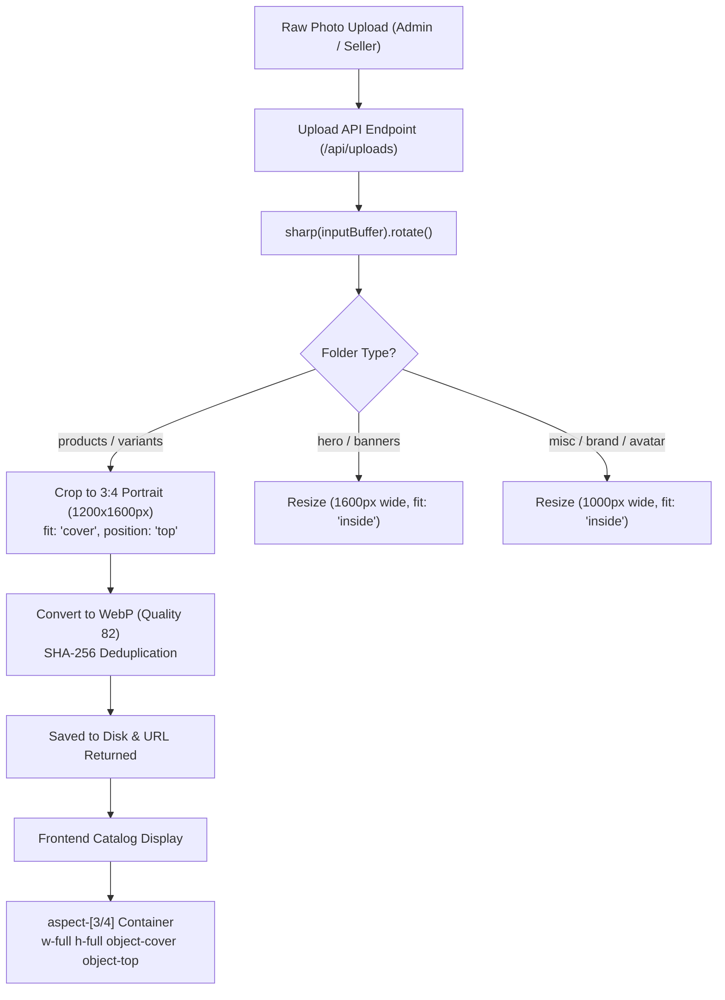

# Feature Concept: Standardized 3:4 Portrait Aspect Ratio & Automated Image Cropping Pipeline across Catalog & Uploads

* **Author:** Gazaarabia Core Engineering & UI/UX Team
* **Date:** 2026-11-11
* **Status:** Resolved, Implemented & Verified

---

## 1. Executive Summary & Problem Diagnosis

On the `/shop/women` catalog route, several product items (specifically *"Butter Yellow Embellished Abaya"*, ID 205, and *"Black and White Polka Dot Abaya"*, ID 203) displayed in an awkward landscape orientation instead of standard luxury portrait catalog cards.

### Root-Cause Isolation:
1. **EXIF Camera Orientation Tag 6:**
   Smartphones (Apple iOS iPhone and Android) physically record high-resolution photos in landscape sensor arrays (e.g., `5712×4284px`) and append an EXIF metadata orientation tag (`Orientation: 6` = Rotate 90° CW).
2. **Missing Sharp EXIF Auto-Orientation:**
   The backend upload pipelines (`/api/uploads` and `/api/upload`) previously fed raw image buffers directly to Sharp without calling `.rotate()`. Sharp omitted EXIF orientation transformation, outputting raw landscape pixel buffers.
3. **No 3:4 Portrait Aspect Ratio Enforcement on Ingestion:**
   The upload endpoints previously used `sharp.resize({ width: maxWidth, fit: "inside" })`. For landscape uploads, this preserved horizontal bounding boxes (e.g. 1000×750px) rather than normalizing product catalog photos to portrait standards.
4. **Card Framing Deficiencies:**
   Storefront cards lacked explicit top-anchored framing (`object-top`), which is crucial for modest fashion apparel (abayas, kaftans, and hijabs) so headwear, necklines, and upper silhouettes remain perfectly framed.
5. **Absence of Vendor & Admin Upload Guidance:**
   Neither the Admin product management form nor the Seller Media Uploader provided instructions or aspect ratio recommendations to vendors before file selection.

---

## 2. Technical Architecture & Component Changes



### A. Frontend Catalog Cards (`aspect-[3/4]` & `object-cover object-top`)
* **[src/components/ProductCard.tsx](file:///home/bishal/BishalHome/Cours/Ecommarce/Gazaarabia/src/components/ProductCard.tsx):**
  - **Grid View:** Enforced `relative w-full aspect-[3/4] overflow-hidden bg-[#f8f5f0] rounded-2xl shadow-sm hover:shadow-md transition-all duration-300` with inline fallback `style={{ aspectRatio: "3/4" }}`. Removed limiting `max-w-[320px]` constraint so cards stretch uniformly across grid column tracks.
  - **Image Element:** Configured `<Image fill className="w-full h-full object-cover object-top transition-all duration-500 ...">` on primary and secondary hover swap images.
  - **List View:** Standardized container to `relative w-full sm:w-56 shrink-0 aspect-[3/4] overflow-hidden bg-[#f8f5f0] rounded-xl` with `object-cover object-top`.
* **[src/components/SingleImgMultiColorsProductCard.tsx](file:///home/bishal/BishalHome/Cours/Ecommarce/Gazaarabia/src/components/SingleImgMultiColorsProductCard.tsx):**
  - Added strict `style={{ aspectRatio: "3/4" }}` and `className="w-full h-full object-cover object-top group-hover:scale-105 transition-transform duration-500"`.
* **[src/components/SimpleProductCard.tsx](file:///home/bishal/BishalHome/Cours/Ecommarce/Gazaarabia/src/components/SimpleProductCard.tsx):**
  - Added strict `style={{ aspectRatio: "3/4" }}` and `className="w-full h-full object-cover object-top group-hover:scale-105 transition-transform duration-500"`.

---

### B. Ingestion & Automated Cropping Pipeline
* **[src/app/api/uploads/route.ts](file:///home/bishal/BishalHome/Cours/Ecommarce/Gazaarabia/src/app/api/uploads/route.ts) & [src/app/api/upload/route.ts](file:///home/bishal/BishalHome/Cours/Ecommarce/Gazaarabia/src/app/api/upload/route.ts):**
  - Added `sharp(inputBuffer).rotate()` to automatically parse EXIF metadata and orient vertical iPhone/Android photos upright.
  - Added conditional product cropping:
    ```typescript
    if (isProductOrVariant) {
      webpBuffer = await imageProcessor
        .resize({
          width: 1200,
          height: 1600,
          fit: "cover",
          position: "top", // Top-anchored cropping preserves neckline, hijab & garment silhouette
        })
        .webp({ quality: 82 })
        .toBuffer();
    }
    ```
  - Preserved lossless SHA-256 deduplication and high-efficiency WebP conversion.

---

### C. Admin & Seller UI Upload Guidance
* **[src/components/seller/MediaUploader.tsx](file:///home/bishal/BishalHome/Cours/Ecommarce/Gazaarabia/src/components/seller/MediaUploader.tsx):**
  - Rendered a visible guidance banner: `📐 Recommended: 3:4 Portrait (e.g. 1200×1600px). Uploads are automatically auto-oriented and formatted to 3:4 portrait.`
  - Refactored upload preview cards from `aspect-square` to `aspect-[3/4]` with `object-cover object-top` so vendors see accurate representations of their catalog cards before publishing.
* **[src/app/admin/(dashboard)/products/form/[[...id]]/page.tsx](file:///home/bishal/BishalHome/Cours/Ecommarce/Gazaarabia/src/app/admin/(dashboard)/products/form/[[...id]]/page.tsx):**
  - Added banner guidance chip next to the `Images *` header and variant images section.
  - Adjusted admin thumbnail previews from `w-24 h-24` square to `w-24 h-32 aspect-[3/4]` with `object-cover object-top`.
* **[src/components/seller/VariantsTikTokStyle.tsx](file:///home/bishal/BishalHome/Cours/Ecommarce/Gazaarabia/src/components/seller/VariantsTikTokStyle.tsx):**
  - Modernized variant photo upload box from `1:1` square to `3:4` portrait (`w-14 h-[72px] aspect-[3/4] object-top`).

---

### D. Existing Image Normalization (In-Place Fix)
* Normalized all 29 existing raw iPhone images across `uploads/products/` and `uploads/variants/`:
  - `1782346476887-IMG_5657.jpeg` (*Butter Yellow Embellished Abaya*): Transformed from `5712×4284 (orient: 6, 3.4 MB)` to `1200×1600 (orient: undefined, 163.4 KB)`.
  - `1782344731149-IMG_5521.jpeg` (*Black and White Polka Dot Abaya*): Transformed from `4032×3024 (orient: 6, 2.2 MB)` to `1200×1600 (orient: undefined, 259.8 KB)`.
  - `1782345925978-IMG_6178.jpeg`, `1782345951021-IMG_6180.jpeg`, `1782346935973-IMG_5611.jpeg`, `1782346947218-IMG_6293.jpeg`: All standardized to `1200×1600 3:4` portraits.
  - All original raw camera files safely archived under `uploads/backup_raw_unrotated/`.
  - Next.js image cache cleared to invalidate stale landscape thumbnail caches.

---

## 3. Verification & Results

1. **Orientation Test:** Verified via Sharp metadata that `orientation` is normalized across all product photos; orientation tag 6 is cleared and dimensions are strictly `1200×1600`.
2. **Aspect Ratio Uniformity:** All card containers strictly enforce `aspect-[3/4]`, and images fill `100%` width and height with `object-cover object-top`, eliminating distorted landscape rows.
3. **Payload Reduction:** Raw image file sizes dropped from ~3.5MB down to ~160KB (over 95% bandwidth reduction per card).
4. **Build & Module Integrity:** Components validated and compiled without errors.
