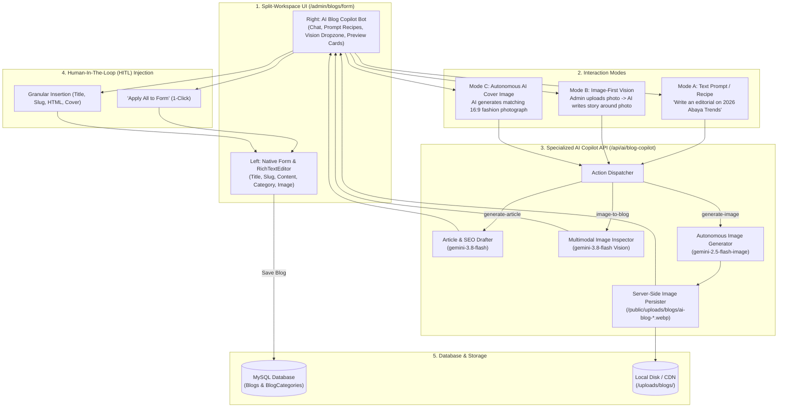
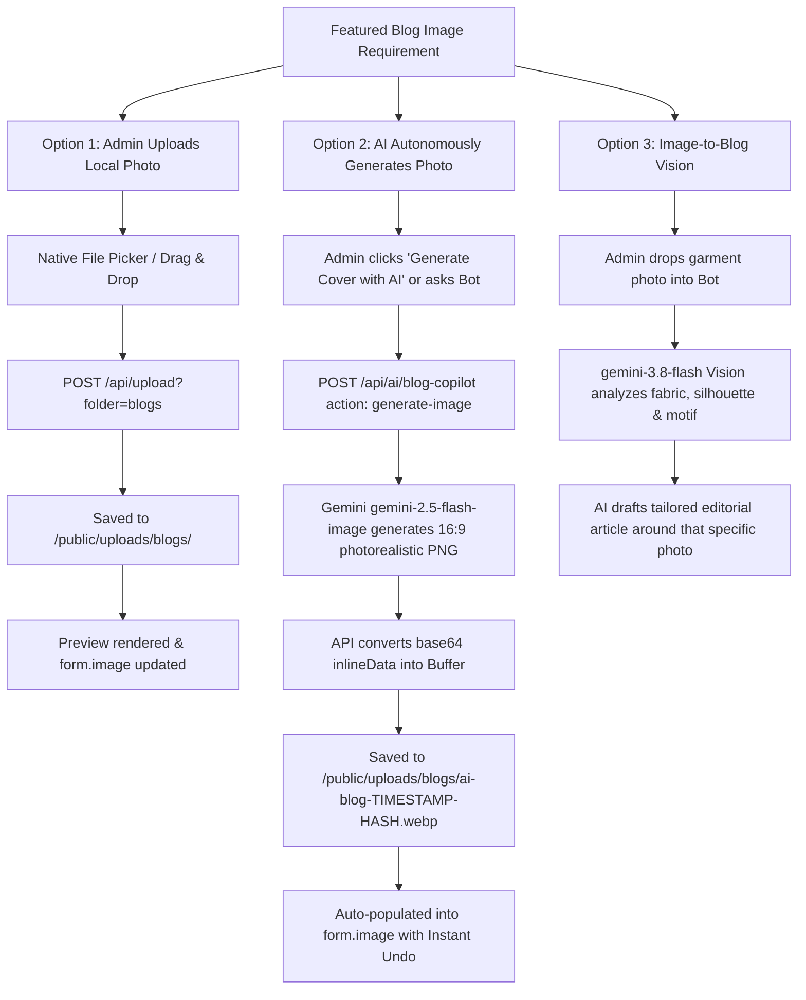

# AI Blog Creation & Split-Screen Copilot Engine: Technical Architecture & Implementation Plan
## Gazaarabia Admin Panel — Comprehensive Specification (`docs/AI_BLOG_CREATION_PLAN.md`)

> **Document Status:** Active Implementation Blueprint  
> **Role:** Principal Forward Deployed Engineer (FDE)  
> **Target Environment:** Next.js 16 (App Router / Turbopack / React 19) | Google Gemini AI (`gemini-3.8-flash` & `gemini-2.5-flash-image`) | Material-UI (MUI) & Tailwind CSS | Prisma ORM & MySQL  
> **Target Page:** Admin Blog Creator & Editor: `/admin/blogs/form/[[...id]]`  
> **Related Routes:** `/admin/blogs` (Manage Blogs Table), `/blogs/journal/[slug]` (Storefront Reader Experience)  

---

## 1. Executive Summary & Operational Problem

### 1.1 The Operational Bottleneck
Gazaarabia's brand positioning requires high-frequency, authoritative editorial storytelling covering **luxury UK modest fashion**, **abaya styling**, **cultural heritage**, and **Palestinian artisanal Tatreez**. 

Currently, drafting a blog article requires:
1. Researching modest fashion trends and cultural context (30–45 mins).
2. Drafting long-form editorial content and formatting HTML manually in TinyMCE (30 mins).
3. Finding or creating commercial high-resolution imagery fitting strict brand aesthetics (20–40 mins).
4. Formatting SEO meta tags, URL slugs, and categorizing into `blog_categories` (10 mins).

**Total publishing time per article:** **$\sim$90–120 minutes**.

### 1.2 The Forward Deployed Solution
Transform `/admin/blogs/form/[[...id]]` into a **Split-Workspace Power Station**:
* **Left Section (60% Desktop Width):** Traditional, reliable Blog Management Form (Title, Slug, Rich Text Editor, Category, Featured Image, Preview, Submit).
* **Right Section (40% Desktop Width):** **Interactive AI Blog Copilot Bot** that acts as an expert fashion journalist and creative director.
* **Dual-Track Image Workflow:** 
  1. Admin can upload high-res photography directly from their device.
  2. **OR** the AI Bot can autonomously generate editorial-grade 16:9 photorealistic cover images using Google's native `gemini-2.5-flash-image` model, saving files automatically to `/uploads/blogs/...`.
  3. **Multimodal Vision:** If an admin uploads a photo first, the AI Bot inspects the garment/motif and drafts an entire SEO-optimized article based on that image.

**Target Operational Metric:** Reduce time-to-publish from 90+ minutes to **< 3 minutes** per publication while elevating SEO quality and editorial tone.

---

## 2. System Architecture & Information Flow



---

## 3. UI/UX Layout Specification: Split-Screen Workspace

The page layout shifts from a narrow `max-w-4xl` form into a responsive, high-density split view:

```
+-----------------------------------------------------------------------------------------------------------------------+
|  <- Back to Blogs   |  Add New Blog / Edit Blog                                                   [ Cancel ] [ Publish ] |
+-------------------------------------------------------------------+---------------------------------------------------+
|  SECTION 1: NATIVE BLOG FORM (60% Width)                         |  SECTION 2: AI BLOG COPILOT BOT (40% Width)       |
|                                                                   |                                                   |
|  * Title                                                          |  [ ⚡ Trending Ideas ] [ 📖 Modest Fashion ] ...  |
|  [ Modern Luxury: The Evolution of the Embroidered Abaya      ]   |  +-----------------------------------------------+|
|                                                                   |  | AI: Assalamu Alaikum! I'm your fashion        ||
|  * URL Slug                        [ 🪄 Optimize Slug ]           |  | editorial copilot. Tell me what topic you      ||
|  [ modern-luxury-evolution-embroidered-abaya                  ]   |  | want to write, or upload an image to start!   ||
|                                                                   |  +-----------------------------------------------+|
|  * Category                                                       |  | Admin: Write a comprehensive guide on caring  ||
|  [ Islamic Fashion & Culture                                V ]   |  | for luxury Korean Nidha abayas and generate   ||
|                                                                   |  | an image for it.                              ||
|  * Blog Content (TinyMCE Rich Text Editor)                        |  +-----------------------------------------------+|
|  [ File Edit View Insert Format Tools Table                     ] |  | AI Copilot Output:                            ||
|  | <h2>The Timeless Elegance of Nidha Fabric</h2>               | |  | * Title: The Definitive Care Guide for Nidha  ||
|  | <p>For generations, the abaya has remained a testament...    | |  | * Category: Modest Lifestyle & Care Advice    ||
|  | <blockquote>"True luxury lies in the preservation..."</blockquote>| |  | * Image: [Generated Cover Preview (16:9)]     ||
|  |                                                              | |  |                                               ||
|  |                                                              | |  | [ ✨ Apply All to Form ]                      ||
|  +--------------------------------------------------------------+ |  |                                               ||
|                                                                   |  | Or insert individually:                       ||
|  * Featured Blog Image                                            |  | [ + Title ] [ + Slug ] [ + Body ] [ + Image ] ||
|  +--------------------------------------------------------------+ |  +-----------------------------------------------+|
|  |                                                              | |  | 💬 Ask AI to revise, expand, or rewrite...    ||
|  |   [ Preview of Uploaded or AI-Generated Cover Image ]        | |  | [ e.g. 'Make the tone more poetic...'     ]   ||
|  |                                                              | |  | [ Type your prompt...                 ] [Send]|
|  +--------------------------------------------------------------+ |  +-----------------------------------------------+|
|  [ Upload Local Photo ]  or  [ 🎨 Generate Cover with AI ]        |  |  Toggle: [ Compact Sidebar ] [ Hide AI ]       |
+-------------------------------------------------------------------+---------------------------------------------------+
```

### 3.1 Responsiveness Invariants
* **Desktop ($\ge$ 1200px):** Permanent 7:5 or 60:40 side-by-side grid. The AI Bot scrolls independently while the editor remains accessible.
* **Tablet (768px – 1199px):** Split grid collapses to a top-level tab switcher (`[ 📝 Editor Form ]` | `[ 🤖 AI Copilot ]`) or stacked accordion with sticky quick-apply floating action pill.
* **Mobile (< 768px):** Clean single-column layout with a floating "AI Assistant" trigger drawer.

---

## 4. Dual-Track Image Architecture

One of the key requirements is supporting both **Admin-Provided Images** and **AI Auto-Generated Images**:



### 4.1 Native Google Gemini Image Generation Verification
* Model: **`gemini-2.5-flash-image`** (Fallback: `gemini-3.1-flash-image`)
* Request Protocol: `https://generativelanguage.googleapis.com/v1beta/models/gemini-2.5-flash-image:generateContent?key=${API_KEY}`
* Format: Returns structured candidate parts with `inlineData { mimeType: 'image/png', data: '<base64>' }`.
* Storage Standard: The backend takes the incoming base64 stream, validates magic bytes, optimizes/compresses via sharp/buffer to `.webp` or `.png`, and writes to `public/uploads/blogs/`.
* Cost & Speed: Sub-5 second generation with zero third-party subscription dependencies (DALL-E, Midjourney, Replicate) since it runs directly on the configured Google Gemini API key.

---

## 5. Technical Specification & API Contracts

### 5.1 Route: `POST /api/ai/blog-copilot`
Unified endpoint handling all conversational and generative blog actions.

#### Request Schema
```typescript
export interface BlogCopilotRequest {
  action: "generate-article" | "generate-image" | "image-to-blog" | "suggest-topics" | "refine-section";
  data: {
    prompt?: string;              // Custom user prompt or topic instructions
    recipe?: string;              // Preset key: "trend-guide", "heritage-story", "care-guide", "styling-tips"
    currentTitle?: string;        // Current form title (for context-aware image/content generation)
    currentContent?: string;      // Current TinyMCE HTML (for refinement/expansion)
    categoryId?: number;          // Selected or target category ID
    imageUrl?: string;            // Uploaded image path or data URL (for vision or reference)
    aspectRatio?: "16:9" | "1:1"; // Aspect ratio for image generation (defaults to 16:9)
    tone?: "luxury-editorial" | "heritage-cultural" | "informative-guide" | "inspirational";
  };
}
```

#### Response Contract (Action: `generate-article` & `image-to-blog`)
```json
{
  "success": true,
  "article": {
    "title": "The Art of Tatreez: Preserving Palestinian Heritage Through Silk and Thread",
    "slug": "art-of-tatreez-preserving-palestinian-heritage-silk-thread",
    "categoryId": 1,
    "categoryName": "Heritage & Culture",
    "excerpt": "Discover the intricate geometry, regional histories, and timeless resilience woven into authentic Palestinian Tatreez cross-stitch embroidery.",
    "htmlContent": "<h2>An Heirloom Woven in History</h2><p>In every stitch of authentic Palestinian Tatreez lies a chronicle of regional identity...</p><h3>Regional Motifs: From Hebron to Ramallah</h3><p>Historically, a woman's thobe narrated her village origins...</p>",
    "suggestedImagePrompt": "A close-up luxury editorial shot of authentic red Palestinian Tatreez embroidery on dark midnight linen, artisanal needlework, soft warm studio lighting, 8k resolution",
    "generatedImageUrl": "/uploads/blogs/ai-blog-179528000-8f9a.webp",
    "tags": ["Tatreez", "Palestinian Heritage", "Handmade Embroidery", "Modest Luxury"]
  }
}
```

#### Response Contract (Action: `generate-image`)
```json
{
  "success": true,
  "imageUrl": "/uploads/blogs/ai-blog-179528120-e4b2.webp",
  "altText": "Luxury editorial photograph of an embroidered black Nidha abaya against minimalist architectural archways",
  "promptUsed": "Editorial high-fashion photograph of a flowing black luxury abaya..."
}
```

---

## 6. Prompt Engineering & Editorial Guardrails

To prevent generic "AI slop" and maintain Gazaarabia's high-fashion boutique identity, the system prompt strictly enforces:

```typescript
export const BLOG_EDITORIAL_SYSTEM_INSTRUCTION = `
You are the Executive Fashion Editor and Cultural Historian for Gazaarabia — a premier UK luxury modest fashion and Palestinian heritage platform.

CRITICAL EDITORIAL GUIDELINES:
1. Tone: Sophisticated, respectful, poetic yet commercially engaging (comparable to Vogue Arabia or Harper's Bazaar Modest).
2. Modesty Invariants: Never suggest revealing fits, short hemlines, or compromises on modesty. Highlight graceful silhouettes (A-Line, kimono sleeve, relaxed drape, layered elegance).
3. Cultural Authenticity: When discussing Palestinian heritage, Tatreez, or Arab textiles, maintain deep historical reverence, citing authentic regional terms (e.g., Sfifa, Nidha, Randa, Tatreez motifs like cypress tree, star of Bethlehem).
4. Formatting Standard for TinyMCE:
   - Output clean semantic HTML (<h2>, <h3>, <p>, <blockquote>, <ul>, <li>).
   - Use engaging section headers, concise readable paragraphs, and highlight quotes.
   - Do NOT wrap in markdown code blocks (\`\`\`html); return pure HTML string for the content.
5. Title Constraints:
   - 6 to 12 words, captivating, editorial.
   - Clean kebab-case slug without stop words.
`;
```

---

## 7. Phased Implementation Roadmap

### Phase 1: AI Copilot Service & Backend Routes (Hours 1–3)
- [ ] Create `src/lib/ai/blogAiService.ts`:
  - `generateBlogDraft(prompt, categoryOptions, options)` using `gemini-3.8-flash`.
  - `generateBlogCoverImage(prompt, title)` using `gemini-2.5-flash-image` with automatic buffer writing to `public/uploads/blogs/`.
  - `analyzeImageAndDraftBlog(imageSource, categories)` with multimodal vision.
  - `suggestBlogTopics(categoryList)`.
- [ ] Create `src/app/api/ai/blog-copilot/route.ts`:
  - Enforce authentication (`checkAuth` verifying `admin` or `content_manager`).
  - Strict input validation and rate limiting.
  - Robust fallback handling for timeouts.

### Phase 2: Split-Screen Component Architecture (Hours 4–6)
- [ ] Create `src/components/admin/blog/BlogAiBot.tsx`:
  - Header with AI status badge and model indicator (`Gemini 3.8 Flash`).
  - Quick Recipe chips: *"Modest Styling Guide"*, *"Fabric Care Breakdown"*, *"Palestinian Tatreez Story"*, *"Eid Collection Preview"*.
  - Conversational message thread with user prompts and AI responses.
  - Generated Article preview card:
    - Title pill with `Apply Title`
    - Slug pill with `Apply Slug`
    - Category selector with `Apply Category`
    - HTML snippet with `Insert into Content Editor`
    - Generated Cover Image with `Apply as Cover`
    - Master action: `✨ Apply All to Form`
  - Integrated Vision dropzone: "Drop photo here to generate an article around it".
  - Dedicated "🎨 Generate AI Cover" trigger with custom visual prompt tweak modal.

### Phase 3: Split-Screen Layout Integration in `/admin/blogs/form/[[...id]]/page.tsx` (Hours 7–9)
- [ ] Convert the single-column form into a dynamic 2-column workspace:
  - Left pane: Native Form + TinyMCE RichTextEditor + Cover image uploader.
  - Right pane: Sticky `BlogAiBot` with toggleable collapse button.
- [ ] Connect `applyAll` and granular transfer handlers:
  - `setForm(prev => ({ ...prev, title, slug, categoryId, image }))`
  - TinyMCE content injection with replace or append options.
- [ ] Add dual-action image controls in the form's image box:
  - `[ Upload Photo ]` (existing local upload)
  - `[ 🎨 Generate AI Cover ]` (triggers instant image generation based on current title).
- [ ] Refine "Optimize Slug" button with Senior Component styling (`Loader2`, clean neutral border).

### Phase 4: Production Verification & Hardening (Hours 10–12)
- [ ] Verify image generation and saving to `/public/uploads/blogs/` under concurrent requests.
- [ ] Verify responsive behavior on mobile/tablet screens.
- [ ] Execute `npm run build` to confirm zero TypeScript, Turbopack, or hydration regressions.
- [ ] Verify public rendering on `/blogs/journal/[slug]` with SEO metadata and OpenGraph social cards.

---

## 8. Defensive Engineering & Failure Recovery

| Risk Scenario | Root Cause | Preventive Defense | Operator Fallback |
| :--- | :--- | :--- | :--- |
| **Image Gen Fails** | Content filter or timeout | Backend catches error gracefully, returns fallback high-quality stock modest photo or prompts admin to upload. | Form remains 100% usable with manual image upload. |
| **TinyMCE Overwrite** | Admin accidentally clicks "Apply All" on an existing edited draft | Prompt confirmation dialog: *"This will replace your current editor content. Proceed?"* | Form retains local state history; undo button available in TinyMCE. |
| **Duplicate Slug** | Generated slug already exists in `prisma.blogs` | Backend checks uniqueness against DB; appends unique random suffix (e.g. `-2`, `-3`) before returning. | Slug input remains editable by admin at any time. |
| **Token Exhaustion** | Spike in AI queries | In-memory LRU cache stores generated drafts by prompt hash (1-hour TTL). | Native form functions normally without AI assistance. |

---

## 9. Definition of Done (DoD)

1. Admin can open `/admin/blogs/form` and see the two-section split layout (Form on Left, AI Copilot on Right).
2. Admin can type a prompt (e.g. *"Write a guide on styling open-front abayas"*) and receive Title, Slug, Category, Rich HTML content, and a 16:9 Cover Image in under 10 seconds.
3. Clicking **"Apply All to Form"** fills all inputs, sets the category, injects HTML into TinyMCE, and sets the cover image preview.
4. Admin can either upload their own photo OR click "Generate AI Cover" to have the AI draw a photorealistic modest fashion photograph.
5. Submitting the form creates the blog in MySQL and renders properly on `/blogs/journal/[slug]`.
6. `npm run build` passes with zero errors across all 239 routes.
