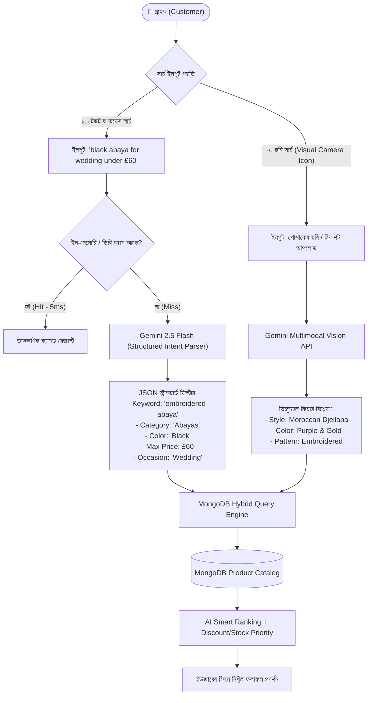

# Alibaba-Style AI Smart Search with Google Gemini API (Paid Tier)
## Gazaarabia E-Commerce Platform

---

## ১. ভূমিকা ও লক্ষ্য (Goal Description)

Alibaba, AliExpress ও Amazon-এর মতো গ্লোবাল ই-কমার্স জায়ান্টদের সার্চ ইঞ্জিন শুধু আক্ষরিক শব্দ (Literal keywords) খোঁজে না; বরং **ব্যবহারকারীর মনের ইচ্ছা (User Intent), প্রসঙ্গ (Context), পোশাকের ধরণ এবং ছবি (Visual Search)** বুঝে মুহূর্তের মধ্যে সঠিক পণ্য তুলে ধরে।

এই পরিকল্পনার লক্ষ্য হলো **Google Gemini Paid API** ব্যবহার করে গাজায়ারাবিয়া (Gazaarabia) প্ল্যাটফর্মে একটি বিশ্বমানের **Alibaba-Style AI Search Engine** তৈরি করা।

---

## ২. আলিবাবা-স্টাইল এআই সার্চ আর্কিটেকচার (How It Works)



---

## ৩. প্রধান ৪টি এআই সার্চ ফিচার (The 4 Core Pillars)

### পিলার ১: ইন্টেলিজেন্ট ন্যাচারাল ল্যাঙ্গুয়েজ ইনটেন্ট পার্সিং (Gemini Intent Engine)
গ্রাহকরা যেভাবে কথা বলেন, সেভাবেই সার্চ করবেন:
* **উদাহরণ ১ (টাইপো ঠিক করা):** ইউজার লিখল `"wedin abya"`
  * **Gemini অ্যাকশন:** অটোমেটিক বের করবে `Did you mean: wedding abaya` এবং কোনো ফাঁকা পেইজ না দেখিয়ে বিয়ের উপযোগী আবায়াগুলো সামনে আনবে।
* **উদাহরণ ২ (বাজেট ও অকেশন ভিত্তিক):** ইউজার লিখল `"lightweight pastel hijab under 20 pound"`
  * **Gemini অ্যাকশন:**
    ```json
    {
      "cleanQuery": "pastel hijab",
      "categoryId": 12,
      "color": "pastel",
      "priceMax": 20,
      "tags": ["lightweight", "breathable", "summer"],
      "correctedQuery": null
    }
    ```
  * এটি সরাসরি আমাদের প্রোডাক্ট ফিল্টার ব্যাকএন্ডে ইনজেক্ট হবে।


### পিলার ৩: জিরো-রেজাল্ট প্রিভেনশন ও সেম্যান্টিক ম্যাচিং (Zero-Result Fallback)
* প্রচলিত ই-কমার্স সার্চে ইউজার যদি এমন কিছু লেখে যা টাইটেলে নেই (যেমন: *"মক্কা-মদিনা ওমরাহ হজের জন্য আরামদায়ক পোশাক"*), তবে সাধারণত **"0 Products Found"** দেখায়, ফলে কাস্টমার সাইট ছেড়ে চলে যায়।
* **আলিবাবা স্টাইল সলিউশন:**
  * Gemini বুঝতে পারবে এর অর্থ: *সাদা বা হালকা রঙের সুতি/লিনেন ঢিলেঢালা আবায়া ও বোরকা*।
  * ব্যাকএন্ডে রিলেটেড সিমিলার ট্যাগ দিয়ে সঠিক প্রোডাক্টগুলোকে সাজেশন হিসেবে স্ক্রিনে তুলে ধরবে।

---

### পিলার ৪: রিয়েল-টাইম প্রেডিক্টিভ সার্চ প্যানেল (Smart Suggestions Dropdown)
* ইউজার টাইপ করা শুরু করলেই (`SearchResultsPanel.tsx`):
  * **AI Suggested Queries:** ট্রেন্ডিং সার্চ ট্যাগগুলো নিচে লাইভ শো করবে।
  * **ইনস্ট্যান্ট ফিল্টার পিলস:** যেমন: `[Category: Abayas]`, `[Color: Black]`, `[Price: < £50]`, যাতে ইউজার এক ক্লিকে ফিল্টার করতে পারেন।
  * **ভিডিও ও ইমেজ ব্যাজ:** পণ্যটিতে হোভার করলে ভিডিও প্রিভিউ চালু হবে (যা আমরা ইতিপূর্বে যুক্ত করেছি)।

---

## ৪. পেইড জেমিনি এপিআই খরচ ও ক্যাশিং স্ট্র্যাটেজি (Cost & Performance Optimization)

যেহেতু আপনি **Paid Gemini API** ব্যবহার করবেন, তাই পারফরম্যান্স ও বিলিং অপ্টিমাইজেশন অত্যন্ত গুরুত্বপূর্ণ:

1. **Gemini 2.5 Flash / 1.5 Flash নির্বাচন:**
   * অত্যন্ত দ্রুত (রিসপন্স টাইম মাত্র ১৫০-৩০০ মিলি-সেকেন্ড)।
   * খরচ অত্যন্ত কম (ইনপুট প্রতি ১ মিলিয়ন টোকেনে মাত্র $0.075 - $0.15 সেন্ট)।
2. **স্মার্ট মেমোরি ক্যাশিং (Search Query Cache):**
   * যেসব সাধারণ শব্দ মানুষ বারবার সার্চ করে (যেমন: "Black Abaya", "Chiffon Hijab", "Eid Collection") সেগুলো ৬০ মিনিট বা ২৪ ঘণ্টার জন্য ইন-মেমোরি ক্যাশে থাকবে।
   * ফলে শতকরা ৭০% সার্চের জন্য কোনো এপিআই কলই খরচ হবে না—**রেসপন্স টাইম হবে মাত্র ৫ মিলি-সেকেন্ড এবং এপিআই খরচ $0**।
3. **জেসন স্কিমা মোড (Structured Outputs):**
   * Gemini-কে ফ্রি টেক্সটের বদলে সরাসরি টাইপস্ক্রিপ্ট JSON স্কিমা দেওয়া হবে (`responseMimeType: "application/json"`), ফলে কোনো অপ্রয়োজনীয় টোকেন খরচ হবে না এবং দ্রুত রেজাল্ট আসবে।

---

## ৫. ফাইল আর্কিটেকচার ও পরিবর্তন তালিকা (File Modifications)

```
src/
├── lib/
│   ├── ai/
│   │   ├── geminiClient.ts          # [NEW] সেন্ট্রালাইজড নিরাপদ Gemini API ক্লায়েন্ট
│   │   ├── searchIntentParser.ts    # [NEW] ন্যাচারাল ল্যাঙ্গুয়েজ সার্চ প্রম্পট ও স্কিমা ইঞ্জিন
│   │   └── visualSearchService.ts   # [NEW] ইমেজ আপলোড ও মাল্টিমোডাল ভিশন প্রসেসর
├── app/
│   └── api/
│       └── front-end/
│           └── search/
│               ├── ai-query/route.ts       # [NEW] এআই সার্চ ইন্টেন্ট অ্যানালাইসিস এন্ডপয়েন্ট
│               ├── visual-search/route.ts  # [NEW] ছবি আপলোড থেকে প্রোডাক্ট ম্যাচিং এন্ডপয়েন্ট
│               └── suggestions/route.ts    # [MODIFY] এআই প্রেডিক্টিভ সাজেশনের সাথে ইন্টিগ্রেশন
└── components/
    ├── Header.tsx                          # [MODIFY] সার্চ বারে ক্যামেরা আইকন (Visual Search) যুক্ত
    ├── SearchResultsPanel.tsx              # [MODIFY] এআই ফিল্টার পিলস ও সাজেশনের ড্রপডাউন
    └── search/
        └── VisualSearchModal.tsx           # [NEW] ড্র্যাগ-অ্যান্ড-ড্রপ ফটো সার্চ পপআপ ড্রয়ার
```

---

## ৬. ধাপে ধাপে বাস্তবায়ন রোডম্যাপ (Implementation Roadmap)

| ধাপ | কাজ | প্রত্যাশিত সময় |
| :---: | :--- | :---: |
| **ধাপ ১** | `@google/genai` এসডিকে সেটআপ ও `GEMINI_API_KEY` কনফিগারেশন | আধা ঘণ্টা |
| **ধাপ ২** | এআই কোয়েরি ইন্টেন্ট পার্সার (`searchIntentParser.ts`) তৈরি ও প্রডাক্ট সার্চ এপিআইয়ের সাথে লিংক | ১ ঘণ্টা |
| **ধাপ ৩** | ড্রপডাউন ও সার্চ পেইজে টাইপো ফিক্স ("Did You Mean") ও অটো-ফিল্টার প্রদর্শন | ১ ঘণ্টা |
| **ধাপ ৪** | ভিজুয়াল সার্চ মোডাল (ক্যামেরা আইকন, ইমেজ আপলোড, জেমিনি ভিশন ম্যাচিং) | ১.৫ ঘণ্টা |
| **ধাপ ৫** | ইন-মেমোরি ক্যাশিং, পারফরম্যান্স টেস্টিং ও প্লেরাইট (Playwright) ভ্যালিডেশন | ১ ঘণ্টা |

---

## ৭. পরবর্তী পদক্ষেপ ও আপনার নিশ্চিতকরণ (Next Steps)

আপনার অনুমোদন পেলে আমরা:
1. `.env` ফাইলে আপনার **Gemini Paid API Key** নিরাপদে যুক্ত করব।
2. উপরোক্ত আর্কিটেকচার অনুযায়ী কোনো পুরাতন কোড নষ্ট না করে ধাপে ধাপে এআই সার্চ ফিচারটি চালু করব।
