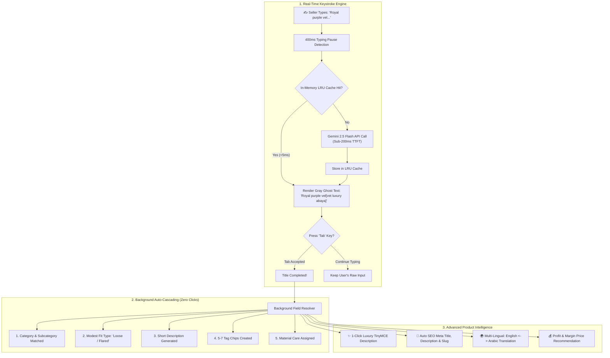

# AI Integration Plan: Next-Word Auto-Complete & Intelligent Product Publishing
## Gazaarabia Admin & Seller Panels — Comprehensive Specification (`docs/AI_PRODUCT_AUTOCOMPLETE_PLAN.md`)

> **Document Status:** Active Implementation Blueprint  
> **Target Environment:** Next.js 16 (App Router / Turbopack / React 19) | Google Gemini Paid API (`gemini-2.5-flash`) | Material-UI (MUI)  
> **Target Pages:**  
> 1. Platform Admin Product Form: `/admin/products/form/[[...id]]`  
> 2. Boutique Seller Product Form: `/seller/products/form/[[...id]]`  

---

## 1. Executive Summary & Recommended Gemini Model

### 1.1 Model Selection & Comparative Rationale

To deliver a lag-free real-time typing experience, model latency is the critical engineering constraint. Below is the evaluation for the Google Gemini Paid API:

| Model Candidate | Latency (TTFT) | Paid API Pricing (per 1M tokens) | Suitability for Real-Time Inline Auto-Complete |
| :--- | :---: | :---: | :--- |
| **`gemini-2.5-flash`** <br>*(Recommended Primary)* | **150ms – 250ms** | **\$0.075 input / \$0.30 output** | **Optimal Choice:** Ultra-fast token streaming, near-instant Time-To-First-Token (TTFT), native JSON schema enforcement, lowest cost for high-frequency typing. |
| **`gemini-1.5-flash`** <br>*(Automated Fallback)* | 200ms – 350ms | \$0.075 input / \$0.30 output | **Reliable Fallback:** Configured as secondary failover if regional endpoints throttle. |
| **`gemini-1.5-pro`** <br>*(Not Recommended for Typing)* | 1,200ms – 2,500ms | \$1.25 input / \$5.00 output | **Unsuitable for Keystrokes:** Too slow for inline autocomplete (user finishes typing before suggestion arrives); 16x more expensive. |

> [!IMPORTANT]
> **Architectural Decision:** We standardize on **`gemini-2.5-flash`** for all real-time inline predictions, field cascading, and description drafting. It delivers sub-250ms responses while keeping token costs to pennies per day across hundreds of seller publishing sessions.

---

## 2. Core AI Feature Suite for "Publish New Product"

The AI integration consists of 6 integrated capabilities designed to turn product publishing into an effortless 60-second workflow without disruptive popups or cluttered modal dialogs:



---

### 2.1 Feature 1: Real-Time Inline Next-Word Auto-Complete (Smart Compose)
- **User Experience**:
  - The seller types in the Product Title input: `"Black nidh..."`
  - After a 400ms pause, faint gray suggestion text (`ghost text`) appears ahead of the cursor: `"...a fabric embroidered abaya for daily elegance"`.
  - Pressing the **`Tab`** or **`Right Arrow`** key accepts the suggestion immediately.
  - Pressing any alphanumeric key ignores the suggestion and continues typing naturally.
- **Zero-Button Philosophy**: No intrusive "AI Copilot" popup or modal banner. The experience feels native, exactly like Google Docs Smart Compose or Gmail.

---

### 2.2 Feature 2: Background Field Auto-Cascading
Once the title is completed or accepted via `Tab`, the background engine cascades data into subsequent form fields:
1. **Category & Subcategory Matching**: AI matches the title against existing database categories (e.g. `"Abayas"` $\rightarrow$ `"Embroidered Abayas"`) and pre-selects them in the dropdown.
2. **Short Description**: If empty, writes a 1–2 sentence high-converting teaser.
3. **Modest Fit Type**: Automatically selects the appropriate fit (`"Modest / Loose Fit"`, `"A-Line Silhouette"`, or `"Regular Fit"`).
4. **Smart Tag Chips**: Generates 5–7 relevant, searchable tags (e.g., `["black abaya", "nidha fabric", "modest fashion", "everyday luxury"]`).
5. **Care Advice**: Suggests matching care instructions from the database (`"Dry Clean Only"` or `"Gentle Hand Wash"`).

---

### 2.3 Feature 3: Luxury Fashion Description Drafter (TinyMCE Integration)
- For the full description, an optional subtle spark icon (`Sparkles`) or smart prompt inside the editor generates a formatted, conversion-optimized modest fashion description:
  - **The Design Narrative**: Story of the silhouette, drape, and styling occasion.
  - **Fabric & Craftsmanship**: Specific weave details (e.g. premium Korean Nidha, breathable velvet).
  - **Modesty Invariants**: Full sleeve coverage, opaque lining, relaxed chest circumference.
  - **Styling Advice**: Pairing with hijabs, footwear, and solidarity brooches.

---

### 2.4 Feature 4: Automated SEO & URL Slug Optimization
- Generates:
  - **Optimized URL Slug**: e.g., `royal-purple-luxury-velvet-abaya` (removing stop words and punctuation).
  - **Meta Title**: `< 60 characters` optimized for Google SERP click-through rate.
  - **Meta Description**: `< 155 characters` containing targeted keywords (`modest wear`, `ethical fashion`, `UK delivery`).

---

### 2.5 Feature 5: Multi-Lingual Translation (English $\leftrightarrow$ Arabic)
- Since Gazaarabia serves international Arab and Western diaspora shoppers, the form provides instant translation for:
  - Product Title (e.g., *"Royal Purple Velvet Abaya"* $\rightarrow$ *"عباية مخملية بلون بنفسجي ملكي"*).
  - Short Description & Tags with authentic modest fashion terminology.

---

### 2.6 Feature 6: Smart Pricing & Profit Margin Advisor
- When a seller inputs a `costPrice` (e.g., £35), AI analyzes category averages and recommends:
  - **Recommended Selling Price**: e.g., £89.00 (healthy 60% gross margin).
  - **Promotional Discount Price**: e.g., £75.00 during sales campaigns.

---

## 3. Technical Architecture & Data Flow

```
[Browser Form: Title Input]
      │
      │ 400ms Debounce + Length >= 3
      ▼
[Client: InlineAutoCompleteInput.tsx]
      │
      ├── Check Local In-Memory LRU Cache (Hits in ~2ms at $0 API Cost)
      │
      ▼ (Cache Miss)
[API: POST /api/ai/inline-autocomplete]
      │
      ├── Auth Verification (NextAuth Session: Seller or Admin role required)
      ├── Rate Limiting (Sliding Window: 60 req/min per IP)
      │
      ▼
[Service: src/lib/ai/productAiService.ts]
      │
      ├── Fetch active categories & brands context (cached in memory)
      │
      ▼
[Google Gemini 2.5 Flash API]
      │
      ├── Prompt: Strict JSON schema { suggestion, cascade: { ... } }
      │
      ▼ (Sub-200ms TTFT)
[Response: Return Suggestion & Cascade Object]
      │
      ▼
[Client: Renders Gray Ghost Text + Pre-selects Categories & Tags]
```

---

## 4. Cost Control & Traffic Optimization

To guarantee that the Gemini Paid API remains ultra-low cost and never saturates network connections:

1. **400ms Keystroke Debouncing**: AI is never queried on every keystroke. It triggers only when the seller pauses for 400ms.
2. **Minimum Character Threshold**: Suggestions activate only when $\ge 3$ characters are typed.
3. **In-Memory LRU Caching**: Common prefix patterns (`"Black nidh"`, `"Purple velv"`) are cached with a 1-hour TTL, serving repeated queries in $<5\text{ms}$ at $\$0$ API cost.
4. **Token Ceiling Limits**: Auto-complete prompts restrict `maxOutputTokens: 150`, keeping API payload size tiny.
5. **AbortController Timeout**: Every request carries an 8-second client timeout; if Gemini is slow, the request is aborted without freezing the form.

---

## 5. File Inventory & Proposed Implementation

```text
src/
├── lib/
│   └── ai/
│       ├── geminiClient.ts                 # Centralized Gemini 2.5 Flash client with LRU cache & circuit breaker
│       └── productAiService.ts             # [NEW] Autocomplete, cascading, description & SEO services
│
├── app/
│   └── api/
│       └── ai/
│           ├── inline-autocomplete/
│           │   └── route.ts                # [NEW] Fast debounced inline ghost-text endpoint
│           └── product-copilot/
│               └── route.ts                # [NEW] On-demand description polish, SEO & translation endpoint
│
├── components/
│   └── ui/
│       └── InlineAutoCompleteInput.tsx     # [NEW] Enhanced MUI TextField with pixel-aligned ghost-text & Tab key
│
└── app/
    ├── admin/(dashboard)/products/form/[[...id]]/
    │   └── page.tsx                        # [MODIFY] Connect InlineAutoCompleteInput & auto-cascading
    └── seller/(dashboard)/products/form/[[...id]]/
        └── page.tsx                        # [MODIFY] Connect InlineAutoCompleteInput & auto-cascading
```

---

## 6. Verification & Quality Assurance Strategy

1. **Keystroke Performance & Ghost-Text Rendering**:
   - Verify that typing `"Black nidh"` displays gray ghost text directly ahead of the cursor without layout shifts or text overlaps.
   - Verify that pressing **`Tab`** or **`Right Arrow`** commits the suggestion into the input value.
   - Verify that continuing to type overrides the suggestion without glitches.
2. **Auto-Cascading State Updates**:
   - Verify that accepting a title automatically pre-selects the correct category and subcategory in the dropdown.
   - Verify that 5–7 tags appear in the tags container as interactive chips.
   - Verify that all auto-filled fields remain 100% editable by the user.
3. **Graceful Fallback on API Key Absence or Failure**:
   - Verify that if `GEMINI_API_KEY` is missing or network times out, the input fields behave normally as standard inputs without throwing errors or blocking the form.
4. **Production Build Validation**:
   - Execute `npm run build` to ensure zero TypeScript errors and 100% route generation across both admin and seller routes.
