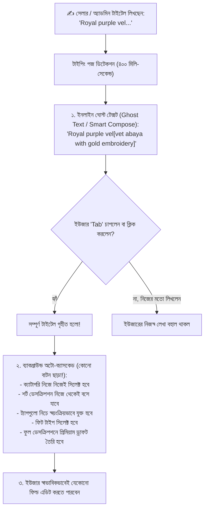

# Real-Time Inline AI Auto-Complete Plan for Publish Product Page
## Admin & Seller Panels — Gazaarabia (No Separate Buttons)

---

## ১. মূল দর্শন ও পরিবর্তন (Core Concept: Zero Extra Buttons)

ব্যবহারকারীর নির্দেশনা অনুযায়ী:
* ফর্মে **কোনো আলাদা "AI Copilot" বাটন, ব্যানার বা পপআপ মোডাল থাকবে না**।
* ব্যবহারকারী যখন ফর্মের যেকোনো ফিল্ডে (যেমন: Title বা Description) লিখতে শুরু করবেন, এআই **স্বয়ংক্রিয়ভাবে রিয়েল-টাইমে লেখাটি অটো-কমপ্লিট (Auto-Complete) করবে** (ঠিক যেমন Google Docs Smart Compose, Gmail, বা আধুনিক স্মার্ট সার্চ কাজ করে)।

---

## ২. ইউজার কীভাবে এটি দেখতে ও ব্যবহার করবেন (User Experience Flow)



---

## ৩. ফিল্ড ভিত্তিক অটো-কমপ্লিটের বিস্তারিত কার্যপ্রণালী

### ১. টাইটেল ইনপুট (Title Field - Smart Ghost Text)
* **অভিজ্ঞতা:**
  * সেলার টাইটেল ফিল্ডে লিখলেন: `"Black nidh..."`
  * সাথে সাথে কার্সরের সামনে হালকা ধূসর (gray ghost text) রঙে ভেসে উঠবে: `"...a embroidered abaya for formal events"`.
  * কিবোর্ডে `Tab` চাপলেই পুরো টাইটেলটি বসে যাবে। অথবা সেলার নিজের মতো টাইপ করে যেতে পারবেন।

### ২. অটো-ক্যাসকেড (Auto-Cascade from Title - কোনো বাটন ছাড়াই!)
* টাইটেল সম্পূর্ণ হওয়ার সাথে সাথেই (ইউজার যখন পরের ফিল্ডে যাবেন বা এন্টার দেবেন):
  * **Category & Subcategory:** ক্যাটাগরি ড্রপডাউনে স্বয়ংক্রিয়ভাবে সঠিক ক্যাটাগরি (যেমন: `Abayas`) এবং সাব-ক্যাটাগরি সিলেক্ট হয়ে যাবে।
  * **Short Description:** ফাঁকা থাকলে এআই স্বয়ংক্রিয়ভাবে ১-২ লাইনের সুন্দর সামারি লিখে দেবে।
  * **Fit Type:** কাপড়ের ধরন বুঝে `Modest / Loose Fit` অটো-সিলেক্ট হয়ে যাবে।
  * **Tags (ট্যাগস):** নিচে স্বয়ংক্রিয়ভাবে ৫-৭টি প্রাসঙ্গিক ট্যাগ চিপ আকারে তৈরি হয়ে যাবে (যেমন: `[black abaya]`, `[nidha fabric]`, `[modest wear]`)। সেলার চাইলে কোনো ট্যাগ 'X' চেপে মুছে দিতে পারবেন।
  * **Full Description (TinyMCE Editor):** এডিটর ফাঁকা থাকলে এআই সেখানে কাপড়ের বিবরণ, কাটিং ও মেটিরিয়াল কেয়ারের একটি সম্পূর্ণ সাজানো ড্রাফট তৈরি করে দেবে।

### ৩. ডেসক্রিপশন ইনলাইন অটো-কমপ্লিট (Writing Inside Description)
* ডেসক্রিপশন লেখার সময় কোনো বাক্য অসমাপ্ত থাকলে (যেমন: *"Crafted from breathable fabric that ensures..."*), এআই বাক্যের বাকি অংশটি হালকা ধূসর রঙে সাজেস্ট করবে: `"...maximum comfort throughout the day and effortless drape."`। `Tab` চাপলেই বাক্যটি সম্পূর্ণ হবে।

---

## ৪. কারিগরি আর্কিটেকচার (Technical Architecture)

```
[ব্রাউজার / ক্লায়েন্ট ফর্ম] 
      │ 
      │ (৪০০ms ডিবাউন্স - কেবল টাইপিং থামলে কল হবে)
      ▼
[Next.js API: POST /api/ai/inline-autocomplete]
      │
      ├── ইনপুট: { field: "title", prefix: "Black nidh", context: {...} }
      │
      ▼
[Google Gemini 2.5 Flash / 1.5 Flash] 
      │ (আল্ট্রা-ফাস্ট: ১৫০-২০০ms রেসপন্স)
      ▼
[JSON রেসপন্স: { suggestion: "a embroidered abaya", cascade: {...} }]
      │
      ▼
[ইনপুট ফিল্ডে গ্রে ঘোস্ট টেক্সট প্রদর্শন / ট্যাগ ও ক্যাটাগরি অটো-সিলেক্ট]
```

### খরচ ও ট্র্যাফিক অপ্টিমাইজেশন (Cost Control):
1. **ডিবাউন্সিং (Debounce 400ms):** প্রতি অক্ষরে এআই কল হবে না। ইউজার টাইপ করা থামানোর পর ৪০০ মিলি-সেকেন্ড অপেক্ষা করে মাত্র একবার কল হবে।
2. **মিনিমাম ক্যারেক্টার লিমিট:** কমপক্ষে ৩-৪ অক্ষর লেখার পর অটো-কমপ্লিট সক্রিয় হবে।
3. **ক্যাশিং:** বহুল ব্যবহৃত সাধারণ টাইটেল/শব্দগুলো লোকাল ব্রাউজার ক্যাশে সংরক্ষিত থাকবে, ফলে অপ্রয়োজনীয় এপিআই কল হবে না।

---

## ৫. ফাইল পরিবর্তন ও কম্পোনেন্ট তালিকা

```
src/
├── lib/
│   └── ai/
│       ├── geminiClient.ts                 # সেন্ট্রালাইজড Gemini Client
│       └── inlineAutocompleteService.ts    # ইনলাইন প্রেডিকশন ও অটো-ক্যাসকেড লজিক
├── app/
│   └── api/
│       └── ai/
│           └── inline-autocomplete/
│               └── route.ts                # লাইটওয়েট ফাস্ট অটো-কমপ্লিট এপিআই
├── components/
│   └── ui/
│       └── AutoCompleteTextField.tsx       # ঘোস্ট-টেক্সট (Ghost text) সাপোর্ট করা রিয়্যাক্ট ইনপুট কম্পোনেন্ট
├── app/
│   ├── admin/(dashboard)/products/form/[[...id]]/page.tsx   # অ্যাডমিন ফর্মে ইনলাইন অটো-কমপ্লিট
│   └── seller/(dashboard)/products/form/[[...id]]/page.tsx  # সেলার ফর্মে ইনলাইন অটো-কমপ্লিট
```

---

## ৬. ভেরিফিকেশন ও টেস্ট প্ল্যান

1. **ইনলাইন টাইপিং টেস্ট:**
   * টাইটেল ফিল্ডে `"Velvet ab..."` লিখলে ধূসর রঙে `"aya"` সাজেস্ট করে কিনা এবং `Tab` চাপলে ইনপুট ভ্যালু আপডেট হয় কিনা।
2. **অটো-ক্যাসকেড টেস্ট:**
   * একটি পূর্ণাঙ্গ টাইটেল লেখা হলে ক্যাটাগরি, ট্যাগ ও ডেসক্রিপশন নিজে নিজেই ফর্মে পপুলেট হয় কিনা।
3. **সেলার স্বাধীনতা টেস্ট:**
   * ইউজার চাইলে যেকোনো ফিল্ড ম্যানুয়ালি মুছে ফেলতে বা পরিবর্তন করতে পারছেন কিনা।
4. **নেক্সটজেএস প্রোডাকশন বিল্ড:**
   * `npm run build` দিয়ে সমস্ত টাইপস্ক্রিপ্ট ও নেক্সটজেএস রুট চেক করা।
