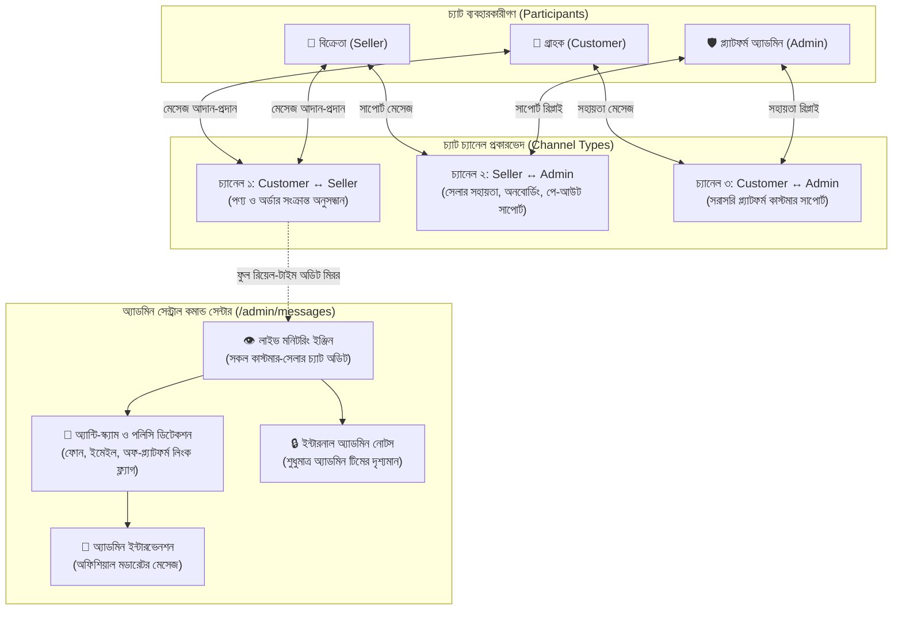
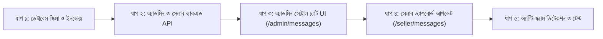

# GAZAARABIA E-COMMERCE: MULTI-TIER CHAT & ADMIN MONITORING SYSTEM
## Comprehensive Architecture, Database Design & Implementation Plan
**Document Version:** 1.0.0  
**Target Platform:** Next.js 15 (App Router), MongoDB, Node.js (MERN Full-Stack)  
**Status:** Architecture & Implementation Plan  

---

## ১. ভূমিকা ও উদ্দেশ্য (Executive Summary)

গাজায়ারাবিয়া (Gazaarabia) প্ল্যাটফর্মে ক্রেতা (Customer), বিক্রেতা (Seller) এবং প্ল্যাটফর্ম অ্যাডমিনদের (Admin) মধ্যে যোগাযোগ রক্ষা, স্বচ্ছতা বজায় রাখা এবং লেনদেনের নিরাপত্তা নিশ্চিত করার জন্য একটি আধুনিক, মাল্টি-টিয়ার চ্যাট সিস্টেম ডিজাইন করা হয়েছে।

### মূল লক্ষ্যসমূহ:
1. **সেলার ও অ্যাডমিন সরাসরি চ্যাট (Seller ↔ Admin Chat):** সেলাররা স্টোর ম্যানেজমেন্ট, পলিসি সংক্রান্ত প্রশ্ন, পেমেন্ট ও পে-আউট সহায়তা নিয়ে সরাসরি প্ল্যাটফর্ম অ্যাডমিনদের সাথে চ্যাট করতে পারবেন। অ্যাডমিনও যেকোনো সেলারকে সরাসরি মেসেজ পাঠাতে পারবেন।
2. **কাস্টমার ও সেলার চ্যাটের উপর অ্যাডমিন মনিটরিং (Admin Real-Time Monitoring of Customer ↔ Seller Chats):** ক্রেতা ও বিক্রেতার মধ্যকার সকল চ্যাট অ্যাডমিন প্যানেল থেকে লাইভ মনিটর করা যাবে। এর ফলে অফ-প্ল্যাটফর্ম পেমেন্ট লেনদেন (Scam Prevention), কন্টাক্ট ইনফো শেয়ারিং বা যেকোনো অসদাচরণ অ্যাডমিন সহজেই শনাক্ত করতে পারবে।
3. **অ্যাডমিন ইন্টারভেনশন ও সমাধান (Admin Intervention & Resolution):** প্রয়োজনে কোনো বিরোধপূর্ণ চ্যাট থ্রেডে অ্যাডমিন হস্তক্ষেপ করতে পারবেন এবং অফিশিয়াল "Platform Moderator" ব্যাজ সহ নির্দেশনা দিতে পারবেন।
4. **অ্যাডমিনের সেন্ট্রাল অল-মেসেজ ড্যাশবোর্ড (`/admin/messages`):** অ্যাডমিনদের জন্য একটি ইন্টারকম/জেনডেস্ক-স্টাইল ৩-পেন (3-Pane) অল-ইন-ওয়ান কমান্ড সেন্টার, যেখানে প্ল্যাটফর্মের সকল চ্যাট ক্যাটাগরি অনুযায়ী ফিল্টার ও সার্চ করা যাবে, গোপন অ্যাডমিন নোট (Internal Admin Notes) রাখা যাবে এবং এক ক্লিকে অ্যাকশন নেওয়া যাবে।

---

## ২. সিস্টেম আর্কিটেকচার ও যোগাযোগ মডেল (System Architecture)



---

## ৩. রোল-ভিত্তিক অ্যাক্সেস ও অনুমতি ম্যাট্রিক্স (RBAC Permissions)

| অ্যাকশন / ফিচার | গ্রাহক (Customer) | বিক্রেতা (Seller) | অ্যাডমিন (Admin) |
| :--- | :---: | :---: | :---: |
| বিক্রেতাকে মেসেজ পাঠানো (পণ্য/অর্ডার) | ✅ হ্যাঁ | ❌ প্রযোজ্য নয় | 👁️ মনিটর করতে পারবেন |
| অ্যাডমিনকে মেসেজ পাঠানো (সেলার সাপোর্ট) | ❌ (সেলার সাপোর্ট নয়) | ✅ হ্যাঁ | ✅ হ্যাঁ (রিপ্লাই দিতে পারবেন) |
| অন্যান্য সেলারের চ্যাট দেখা | ❌ সম্পূর্ণ নিষিদ্ধ | ❌ সম্পূর্ণ নিষিদ্ধ | ✅ সম্পূর্ণ প্ল্যাটফর্মের চ্যাট দৃশ্যমান |
| কাস্টমার-সেলার চ্যাটে হস্তক্ষেপ (Intervene) | ❌ নেই | ❌ নেই | ✅ হ্যাঁ (অফিশিয়াল মডারেটর হিসেবে) |
| ইন্টারনাল গোপন অ্যাডমিন নোট যুক্ত করা | ❌ দেখতে পাবে না | ❌ দেখতে পাবে না | ✅ হ্যাঁ (টিমের জন্য গোপন নোট) |
| চ্যাট ফ্ল্যাগ বা বিরোধ নিষ্পত্তিকরণ (Resolve) | ❌ নেই | ❌ নেই | ✅ হ্যাঁ (Flag / Resolve / Warn) |
| চ্যাট ট্রানস্ক্রিপ্ট এক্সপোর্ট (PDF/CSV) | ❌ নেই | ❌ নেই | ✅ হ্যাঁ (অডিট ও লিগ্যাল পারপাসে) |

---

## ৪. ডেটাবেস স্কিমা ডিজাইন (MongoDB Schema Specifications)

### ৪.১. `conversations` কালেকশন স্কিমা
প্রতিটি কথোপকথনের মেটাডাটা, অংশগ্রহণকারী এবং অ্যাডমিন মনিটরিং ফ্ল্যাগ ধারণ করে:

```typescript
export interface IConversation {
  _id: ObjectId;
  id: number;                          // অটো-ইনক্রিমেন্ট ইউনিক আইডি
  type: "customer_seller" | "seller_admin" | "customer_admin"; // চ্যাট ক্যাটাগরি
  
  // অংশগ্রহণকারীদের রেফারেন্স
  customerId?: number;                 // গ্রাহকের ইউজার আইডি
  sellerId?: number;                   // বিক্রেতার স্টোর আইডি (sellers collection)
  sellerUserId?: number;               // বিক্রেতার মূল ইউজার আইডি (users collection)
  adminId?: number | null;             // অ্যাসাইন্ড অ্যাডমিন আইডি (যদি থাকে)
  
  // প্রোডাক্ট এবং অর্ডার কনটেক্সট (ঐচ্ছিক)
  productId?: number | null;           // যে পণ্য দেখে চ্যাট শুরু হয়েছে
  orderId?: number | null;             // যে অর্ডার সংক্রান্ত চ্যাট
  
  // অ্যাডমিন মনিটরিং ও অডিট ফিল্ডস
  status: "active" | "flagged" | "resolved" | "archived";
  isFlagged: boolean;                  // পলিসি ভায়োলেশনের সন্দেহ হলে true
  flagReason?: string | null;          // যেমন: "External Contact Sharing", "Off-platform payment"
  flaggedAt?: Date | null;
  flaggedBy?: number | null;           // অ্যাডমিন ইউজার আইডি অথবা 0 (অটো-ডিটেক্টেড)
  
  // গোপন অ্যাডমিন নোটস (শুধুমাত্র অ্যাডমিনরা পড়তে পারবেন)
  adminNotes?: Array<{
    id: number;
    adminId: number;
    adminName: string;
    note: string;
    createdAt: Date;
  }>;
  
  // শেষ বার্তার প্রিভিউ
  lastMessageText: string;
  lastMessageAt: Date;
  lastMessageSenderId: number;
  lastMessageSenderRole: "customer" | "seller" | "admin" | "system";
  
  // অপঠিত বার্তার সংখ্যা (রোল অনুযায়ী আলাদা কাউন্টার)
  unreadCountCustomer: number;
  unreadCountSeller: number;
  unreadCountAdmin: number;
  
  createdAt: Date;
  updatedAt: Date;
}
```

### ৪.২. `messages` কালেকশন স্কিমা
চ্যাট থ্রেডের প্রতিটি বার্তার বিস্তারিত তথ্য:

```typescript
export interface IMessage {
  _id: ObjectId;
  id: number;                          // অটো-ইনক্রিমেন্ট ইউনিক আইডি
  conversationId: number;              // সংশ্লিষ্ট কনভারসেশন আইডি
  senderId: number;                    // প্রেরকের ইউজার আইডি
  receiverId?: number;                 // প্রাপকের আইডি (অথবা 0 যদি পুল হয়)
  senderRole: "customer" | "seller" | "admin" | "system";
  
  // সিকিউরিটি: ইন্টারনাল অ্যাডমিন নোট ফ্ল্যাগ
  isInternalAdminNote?: boolean;       // TRUE হলে কাস্টমার ও সেলার এই বার্তা কখনই দেখতে পাবে না
  
  // বার্তার কনটেন্ট
  text?: string;
  mediaUrls?: string[];                // ছবির লিংক (Cloudflare / S3 / Local)
  mediaType: "text" | "image" | "video" | "mixed" | "system_notice";
  videoUrl?: string | null;            // ভিডিও আপলোড লিংক
  
  // রিচ কনটেক্সট কার্ডস
  productContext?: {
    id: number;
    title: string;
    slug: string;
    image: string;
    price: number;
  } | null;
  
  orderContext?: {
    id: number;
    orderNumber: string;
    totalAmount: number;
    orderStatus: string;
  } | null;
  
  // সিস্টেম অথবা মডারেশন অ্যাকশন মেটাডাটা
  metadata?: {
    isOfficialIntervention?: boolean;  // অ্যাডমিন ইন্টারভেনশন মেসেজ হলে গোল্ডেন শিল্ড প্রদর্শন
    systemAction?: string;             // যেমন: "DISPUTE_OPENED", "STORE_WARNED"
  };
  
  // রিড স্ট্যাটাস
  isRead: boolean;
  readAt?: Date | null;
  
  createdAt: Date;
  updatedAt: Date;
}
```

### ৪.৩. ডেটাবেস ইনডেক্সিং স্ট্র্যাটেজি (Performance & Indexing)
উচ্চ ট্র্যাফিক ও কনকারেন্ট চ্যাট হ্যান্ডেল করার জন্য MongoDB ইনডেক্স:
```javascript
// conversations collection indexes
db.collection("conversations").createIndex({ type: 1, updatedAt: -1 });
db.collection("conversations").createIndex({ customerId: 1, sellerId: 1 });
db.collection("conversations").createIndex({ sellerId: 1, lastMessageAt: -1 });
db.collection("conversations").createIndex({ isFlagged: 1, status: 1 });

// messages collection indexes
db.collection("messages").createIndex({ conversationId: 1, createdAt: 1 });
db.collection("messages").createIndex({ receiverId: 1, isRead: 1 });
db.collection("messages").createIndex({ conversationId: 1, isInternalAdminNote: 1 });
```

---

## ৫. এপিআই আর্কিটেকচার ও এন্ডপয়েন্ট ডিজাইন (API Topology)

### ৫.১. কাস্টমার ও সেলার এপিআই (`/api/chat/...`)
1. **`GET /api/chat/conversations`**
   - বর্তমান লগইনকৃত ইউজার (কাস্টমার বা সেলার)-এর থ্রেডগুলো আনে।
   - সেলারদের ক্ষেত্রে কোয়েরি প্যারামিটার `type=customer_seller` অথবা `type=seller_admin` দিয়ে ফিল্টার করা যায়।
2. **`POST /api/chat/conversations`**
   - নতুন চ্যাট থ্রেড শুরু করে (কাস্টমার পণ্য দেখে সেলারের সাথে, অথবা সেলার অ্যাডমিন সাপোর্টের সাথে)।
3. **`GET /api/chat/conversations/[id]/messages`**
   - কথোপকথনের বার্তা লোড করে।
   - **নিরাপত্তা ফিল্টার:** সাধারণ ইউজারদের জন্য `{ isInternalAdminNote: { $ne: true } }` প্রযোজ্য, যাতে অ্যাডমিনদের নিজস্ব নোট ফাঁস না হয়।
4. **`POST /api/chat/conversations/[id]/messages`**
   - টেক্সট, ফটো, ভিডিও বা প্রোডাক্ট রেফারেন্স সহ বার্তা পাঠায়।
   - রিসিভারের আনরিড কাউন্ট বাড়ায়।

---

### ৫.২. অ্যাডমিন মনিটরিং ও সাপোর্ট এপিআই (`/api/admin/chat/...`)
অ্যাডমিনদের জন্য ডেডিকেটেড এন্ডপয়েন্ট (রোল চেকিং: `user.role.name === "admin"` বাধ্যতামূলক):

1. **`GET /api/admin/chat/conversations`**
   - **ফিল্টার কোয়েরি প্যারামস:**
     - `type`: `all` | `customer_seller` | `seller_admin` | `customer_admin`
     - `status`: `all` | `active` | `flagged` | `resolved`
     - `search`: কাস্টমারের নাম, ইমেইল, সেলারের স্টোর নেম, মেসেজের শব্দ দিয়ে পূর্ণাঙ্গ সার্চ।
     - `page`, `limit`: দ্রুত লোডিংয়ের জন্য প্যাজিনেশন (ডিফল্ট ২০টি)।
   - **রেসপন্স:** এনরিচড থ্রেড লিস্ট (অংশগ্রহণকারীদের বিস্তারিত প্রোফাইল সহ)।

2. **`GET /api/admin/chat/conversations/[id]`**
   - নির্দিষ্ট চ্যাট থ্রেডের সম্পূর্ণ মেসেজ হিস্ট্রি (ইন্টারনাল অ্যাডমিন নোট সহ)।
   - সাথে অংশগ্রহণকারী কাস্টমারের অর্ডার হিস্ট্রি এবং সেলারের পারফরম্যান্স রেটিং লোড করে।

3. **`POST /api/admin/chat/conversations/[id]/intervene`**
   - অ্যাডমিন কাস্টমার ও সেলারের চ্যাটে সরাসরি একটি অফিশিয়াল সতর্কবার্তা বা নির্দেশনামূলক মেসেজ পাঠাবেন (`senderRole: "admin"`, `metadata.isOfficialIntervention: true`)।

4. **`POST /api/admin/chat/conversations/[id]/notes`**
   - চ্যাট থ্রেডে ইন্টারনাল অ্যাডমিন নোট যোগ করা (যেমন: *"কাস্টমার ট্র্যাকিং নম্বর চেয়েছে, সেলারকে কল দিয়ে তাগিদ দেওয়া হয়েছে"*), যা শুধুমাত্র অ্যাডমিনরাই দেখতে পাবে।

5. **`POST /api/admin/chat/conversations/[id]/flag`**
   - কোনো চ্যাটকে সন্দেহজনক বা স্প্যাম হিসেবে চিহ্নিত করা (`isFlagged: true`, `flagReason: "Sharing WhatsApp number"`).

6. **`POST /api/admin/chat/conversations/start-seller`**
   - অ্যাডমিন প্যানেল থেকে যেকোনো সেলারকে বেছে নিয়ে সরাসরি অ্যাডমিন-সেলার চ্যাট শুরু করা।

---

## ৬. ইউজার ইন্টারফেস ডিজাইন (UI/UX Architecture)

### ৬.১. অ্যাডমিন লাইভ চ্যাট ও মনিটরিং কমান্ড সেন্টার (`/admin/messages`)
ইন্টারকম ও জেনডেস্কের আদলে তৈরি আধুনিক **৩-কলাম লেআউট (3-Column Layout)**:

```
+--------------------------------------------------------------------------------------------------------------------------+
| 🛡️ GAZAARABIA ADMIN CHAT & MONITORING COMMAND CENTER                                              [🔔 Live Monitoring]   |
+--------------------------+---------------------------------------------------+-------------------------------------------+
| 🔍 সার্চ ও ফিল্টার কলাম    | 💬 সক্রিয় চ্যাট টাইমলাইন (Active Thread Stream)     | 📋 কন্টাক্ট ডসিয়ার ও একশন প্যানেল (Dossier) |
|                          |                                                   |                                           |
| [ অল চ্যাট (24) ]        | 🏷️ থ্রেড: Customer #29 ↔️ Seller Store (Gaza Modest)| 👤 কাস্টমার প্রোফাইল:                      |
| [ সেলার-অ্যাডমিন (5) ]   | 📌 পণ্য: Luxury Silk Abaya (£85.00)               |    - নাম: Fatima Rahman                   |
| [ কাস্টমার-সেলার (19) ]  | ------------------------------------------------- |    - ইমেইল: fatima@example.com            |
| [ ⚠️ ফ্ল্যাগড চ্যাট (3) ] | 👤 Customer (10:14 AM):                           |    - মোট অর্ডার: ৪টি (£320.00)             |
|                          |    "Can I pay via cash outside the website?"      |                                           |
| ------------------------ |                                                   | 🏪 সেলার প্রোফাইল:                        |
| 💬 থ্রেড তালিকা:         | 🚩 [SYSTEM DETECTED: Potential Off-Platform Scam] |    - স্টোর: Gaza Modest Wear              |
|                          |                                                   |    - রেটিং: 4.9 ★ (১২০ রিভিউ)             |
| ▶️ Fatima ↔ Gaza Modest  | 🏪 Seller (10:15 AM):                             |    - সেলার স্ট্যাটাস: Verified Seller     |
|   "Can I pay outside..." |    "Please only purchase through Gazaarabia."     |                                           |
|   [10:15 AM] [🚩 Flagged]|                                                   | 🔒 ইন্টারনাল অ্যাডমিন নোটস:                |
|                          | 🛡️ ADMIN INTERVENTION (You - 10:17 AM):          |    + [নোট যোগ করুন]                       |
| ▶️ Ahmed ↔ Silk Route    |    "Official Notice: All payments must remain on  |    "Seller responded properly to scam     |
|   "Is size 56 available?"|     Gazaarabia platform for buyer protection."     |     inquiry. No penalty needed." - Admin  |
|   [09:40 AM]             |                                                   |                                           |
|                          | ------------------------------------------------- | ⚡ কুইক অ্যাকশনস:                         |
| ▶️ Seller: Al-Aqsa Robes | 📝 মেসেজ বক্স:                                    |    [ ⚠️ Send Formal Warning ]             |
|   ↔️ ADMIN SUPPORT       |    [ Type official intervention or reply...   ]   |    [ ✅ Mark as Resolved ]                |
|   "Payout delayed inquiry"|   ( ) Send as Official Moderator                  |    [ 🚫 Suspend Chat / Account ]          |
|   [08:20 AM] [💬 Support]|   ( ) Add as Private Admin Note                   |    [ 📄 Export PDF Transcript ]           |
|                          |   [ Send Message / Save Note ]                    |                                           |
+--------------------------+---------------------------------------------------+-------------------------------------------+
```

### ৬.২. সেলার ড্যাশবোর্ড মেসেজ পেজ (`/seller/messages`)
- **ডুয়াল-ট্যাব ইনবক্স:**
  1. **গ্রাহক বার্তা (Customer Inquiries):** পণ্য ও ডেলিভারি সম্পর্কিত ক্রেতাদের মেসেজ।
  2. **গাজায়ারাবিয়া অ্যাডমিন সাপোর্ট (Platform Admin Support):** অ্যাডমিনের সাথে সরাসরি প্রাতিষ্ঠানিক যোগাযোগ, পে-আউট ও নোটিস চ্যানেল।
- সেলার স্ক্রিনে স্পষ্টভাবে নির্দেশ থাকবে: *"প্ল্যাটফর্মের বাইরে কোনো লেনদেন বা যোগাযোগ কঠোরভাবে নিষিদ্ধ এবং সকল চ্যাট অ্যাডমিন মডারেশনের আওতাভুক্ত।"*

### ৬.৩. কাস্টমার ড্রয়ার ও মেসেজ পেজ (`CustomerChatDrawer.tsx`)
- ক্রেতা যখন সেলারের সাথে কথা বলবে, কোনো জটিলতা ছাড়াই সাধারণ চ্যাটের মতো দেখবে।
- কোনো বিরোধের সৃষ্টি হলে অ্যাডমিনের হস্তক্ষেপ বার্তা অফিশিয়াল **"Gazaarabia Support / Moderator Notice"** হিসেবে দেখতে পাবে।

---

## ৭. স্বয়ংক্রিয় অ্যান্টি-স্ক্যাম ও ফ্ল্যাগিং ইঞ্জিন (Automated Fraud Detection)

প্ল্যাটফর্মের নিরাপত্তা রক্ষার জন্য চ্যাট সিস্টেমে একটি ব্যাকএন্ড ফিল্টার ইঞ্জিন কাজ করবে:
1. **কীওয়ার্ড ডিটেকশন রুলস:**
   - ফোন নম্বর প্যাটার্ন (`+44`, `07...`, `01...`, `whatsapp`, `call me`).
   - ইমেইল প্যাটার্ন (`@gmail`, `@yahoo`, `paypal`).
   - অফ-প্ল্যাটফর্ম পেমেন্ট নির্দেশক (`bank transfer`, `send direct`, `cash on delivery outside`).
2. **অটোমেটিক অ্যাকশন:**
   - কোনো মেসেজে এই প্যাটার্ন মিললে মেসেজটি ব্লক হবে না (যাতে প্রমাণ সংরক্ষিত থাকে), কিন্তু থ্রেডটি স্বয়ংক্রিয়ভাবে `isFlagged: true` এবং `flagReason: "Suspicious Off-Platform Contact Attempt"` হিসেবে চিহ্নিত হবে।
   - অ্যাডমিনের ড্যাশবোর্ডে **"⚠️ Flagged / Disputes"** ট্যাবে তাৎক্ষণিক সতর্কতা চলে আসবে।

---

## ৮. রিয়েল-টাইম লাইভ চ্যাট কমিউনিকেশন স্ট্র্যাটেজি

1. **ফেজ ১ (রেসিলিয়েন্ট অ্যাডাপটিভ পোলিং - Immediate Zero-Config Setup):**
   - বর্তমান Next.js ও ক্লাউডফ্লেয়ার আর্কিটেকচারে অতিরিক্ত কোনো থার্ড-পার্টি সার্ভার ছাড়াই ৫ সেকেন্ডের পল বা উইন্ডো ফোকাস অ্যাক্টিভ থাকলে ৩ সেকেন্ড পর পর ডেটা ফেচিং।
   - SWR / React Query ক্যাশিং ও অপ্টিমিস্টিক আপডেট।
2. **ফেজ ২ (Server-Sent Events / WebSockets):**
   - `/api/chat/stream` এন্ডপয়েন্ট বা Socket.io ক্লায়েন্ট কানেকশন, যার মাধ্যমে টাইপিং ইন্ডিকেটর (`"Seller is typing..."`) ও সাব-সেকেন্ড লাইভ মেসেজ ডেলিভারি নিশ্চিত হবে।

---

## ৯. বাস্তবায়ন কাজের ধাপসমূহ (Step-by-Step Implementation Roadmap)



### ধাপ ১: ডেটাবেস স্কিমা ও মডেল আপডেট (Database Foundation)
- `conversations` কালেকশনে `type`, `adminId`, `status`, `isFlagged`, `adminNotes`, `unreadCountAdmin` ফিল্ডস যুক্ত করা।
- `messages` কালেকশনে `isInternalAdminNote` এবং `metadata` ফিল্ডস সাপোর্ট নিশ্চিত করা।
- হাই-স্পিড কুয়েরির জন্য ইনডেক্সিং তৈরি করা।

### ধাপ ২: ব্যাকএন্ড কন্ট্রোলার ও রাউটিং (API Endpoints)
- অ্যাডমিন অথেন্টিকেশন ও আরবিক্স গার্ড সহ `/api/admin/chat/conversations` এবং `/api/admin/chat/conversations/[id]/messages` তৈরি।
- বিদ্যমান `/api/chat/conversations` এ `type` ভিত্তিক সেলার-অ্যাডমিন চ্যাট ইনিশিয়েশন হ্যান্ডেল করা।
- সাধারণ ইউজার কুয়েরি থেকে `isInternalAdminNote` ফিল্টার আউট করার সিকিউরিটি রুল এনফোর্স করা।

### ধাপ ৩: অ্যাডমিন অল-মেসেজ ও মনিটরিং পেজ (`src/app/admin/(dashboard)/messages/page.tsx`)
- ৩-পেন ইন্টারফেস তৈরি:
  - লেফট প্যানেল: ফিল্টার ট্যাব, সার্চ বার, থ্রেড লিস্ট, ফ্ল্যাগড ব্যাজ।
  - মিডল প্যানেল: লাইভ মেসেজ হিস্ট্রি, অ্যাডমিন ইন্টারভেনশন মেসেজিং, ইন্টারনাল নোট সেকশন।
  - রাইট প্যানেল: কাস্টমার ও সেলার প্রোফাইল ডসিয়ার, পণ্য/অর্ডার কার্ড, কুইক অ্যাকশন বোতাম।
- অ্যাডমিন সাইডবার মেনুতে `Messages` লিংকটি যুক্ত করা (আনরিড ব্যাজ সহ)।

### ধাপ ৪: সেলার মেসেজিং পেজ আপগ্রেড (`src/app/seller/(dashboard)/messages/page.tsx`)
- "Customer Messages" এবং "Platform Admin Support" এর জন্য ট্যাবড ভিউ যুক্ত করা।
- অ্যাডমিনের সাথে সরাসরি যোগাযোগ করার অপশন চালু করা।

### ধাপ ৫: অ্যান্টি-স্ক্যাম মনিটরিং ও কোয়ালিটি ভেরিফিকেশন
- টেস্ট কাস্টমার ও সেলার অ্যাকাউন্টের মাধ্যমে মেসেজ আদান-প্রদান করে অ্যাডমিন থেকে লাইভ দেখা ও ইন্টারভেনশন মেসেজ পাঠানোর এন্ড-টু-এন্ড টেস্ট পরিচালনা করা।
- ইন্টারনাল অ্যাডমিন নোট কাস্টমার বা সেলারের কাছে কোনোভাবেই যেন দৃশ্যমান না হয় তা শতভাগ নিশ্চিত করা।

---

## ১০. উন্মুক্ত প্রশ্ন ও ডিজাইন সিদ্ধান্ত (Open Questions for Approval)

1. **চ্যাট টাইপ ডিফল্ট ভিউ:**
   - অ্যাডমিন যখন `/admin/messages` খুলবেন, ডিফল্টভাবে কি সব ধরনের চ্যাট (`All Chats`) দেখাবেন নাকি যেগুলোতে আনরিড/ফ্ল্যাগড সমস্যা আছে (`Needs Attention`) সেগুলোকে সবার উপরে প্রায়োরিটি দেবেন?
2. **অটোমেটিক সতর্কবার্তা:**
   - যদি কাস্টমার বা সেলার কোনো ফোন নম্বর বা পেপ্যাল অ্যাকাউন্ট আদান-প্রদান করতে চায়, সিস্টেম কি চ্যাটেই তাৎক্ষণিক একটি লাল রঙের ওয়ার্নিং ব্যানার দেখাবে (*"Security Notice: Never share direct phone or bank information"*), নাকি অ্যাডমিন নীরবে এটি দেখে সিদ্ধান্ত নেবেন?

---
*ডকুমেন্টটি অনুমোদন পেলে এই আর্কিটেকচার অনুযায়ী সরাসরি কোড বাস্তবায়নে যাওয়া যাবে।*
