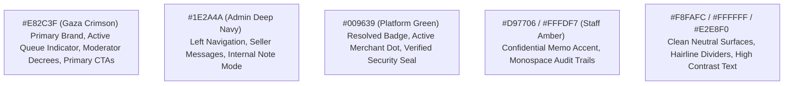

# Gazaarabia Admin Messages & Live Monitoring — UI/UX Redesign Plan

## 1. Executive Summary & Problem Analysis
The current `/admin/messages` interface functional backend is robust (passing 8/8 E2E security, fraud-detection, and moderation tests), but the visual presentation suffered from:
- Monochromatic, wireframe-like aesthetics with insufficient brand character.
- Insufficient visual contrast in conversation queue selection.
- Overly generic, unstyled notices (plain black borders instead of authoritative Gazaarabia moderation badges).
- Lack of clear visual separation between Customer messages, Seller responses, Platform Moderator decrees, and Confidential Staff Notes.
- Flat unformatted text blocks in the Participant Dossier (especially staff audit notes).

This plan establishes a design overhaul using Gazaarabia's brand tokens, Senior Component Architecture guidelines, and Figma Auto-Layout precision.

---

## 2. Design System Tokens & Brand Guidelines

---

## 3. Structural Redesign Phases

### Phase 1: Header & Navigation Bar
- **Breadcrumb Navigation**: Crisp `Messages` / `Moderation Queue` with Inter font.
- **Understated Underline Filter Tabs**:
  - `All` (count badge)
  - `Disputes & Flagged` (rose badge)
  - `Seller Support` (sky badge)
  - `Buyer Inquiries` (neutral badge)
- **Action Buttons**:
  - Rotating queue refresh icon button.
  - `+ New Seller Chat` button in `#1E2A4A` (Admin Deep Navy) with hover depth.

### Phase 2: Left Conversation Queue (`320px`)
- **Search Header**: Hairline search input with magnifying glass and clear focus ring.
- **Conversation Card States**:
  - **Selected**: Solid `border-l-4 border-l-[#E82C3F]` on pure white surface with subtle elevation.
  - **Normal / Hover**: Clean `#FAFBFD` background with smooth transition.
  - **Avatars**: Initial-based circular badge with subtle borders; Headphone icon for Admin Support channels.
  - **Metadata Badges**: `Resolved` (emerald), `Disputed` (crimson), `N notes` (amber lock), and `Policy Watch` (alert triangle).

### Phase 3: Center Conversation Stream
- **Thread Header**: Participant title, active status badge with indicator dot, thread ID and date, `Flag Dispute` toggle, `Resolve / Reopen` button, and Dossier drawer toggle.
- **Scam / Violation Warning**: Dedicated banner when fraud or external contact (WhatsApp/PayPal/email) is detected.
- **Message Types**:
  1. **Customer Message**: Left-aligned white bubble (`bg-white border border-slate-200/90 shadow-2xs`), rounded corners with top-left anchor, sender name, time, and optional policy warning pill.
  2. **Seller Message**: Right-aligned deep navy bubble (`bg-[#1E2A4A] text-white shadow-2xs`) with store avatar `S`.
  3. **Official Moderator Notice**: Centered card with crimson left accent (`border-l-4 border-l-[#E82C3F] bg-white border border-slate-200 shadow-2xs`), shield badge, clear disclaimer, and verified platform stamp.
  4. **Confidential Staff Note**: Centered card with amber left accent (`border-l-4 border-l-amber-500 bg-[#FFFDF7] border border-amber-200/80 shadow-2xs`), lock badge, monospace audit hash, and staff-only privacy disclaimer.

### Phase 4: Docked Moderation Composer
- **Dual-Mode Mode Switch**:
  - Mode 1: `● Public Moderator Notice` (`bg-[#E82C3F] text-white` when active).
  - Mode 2: `🔒 Private Staff Note` (`bg-[#1E2A4A] text-white` when active).
- **Preset Notices Dropdown**: Quick templates for size guide reminders, payment policy warnings, and dispute resolutions.
- **Textarea**: 2-row auto-expanding input with crisp focus ring.
- **Action Bar**: Dynamic hint text + right-aligned submit button (`Post Notice` / `Save Note`).

### Phase 5: Participant Dossier & Staff Notes (`320px`)
- **Customer Card**: Avatar, name, email, phone, and 2-column metrics (`Total Orders`, `Total Spent`).
- **Seller Store Card**: Shop name, merchant active badge, 2-column metrics (`Active Products`, `Store Rating ★ 5.0`), and storefront link.
- **Referenced Product Card**: Image preview, title, price, and link.
- **Staff Audit Ledger**: Lock badge, note count, cards with author, date badge, and monospace note body with audit hash.

---

## 4. Verification & Testing Gate
1. Execute Next.js build / typecheck: `npm run build` or `npx tsx scripts/test_chat_e2e.ts`.
2. Confirm 8/8 test cases pass with 100% success.
3. Validate responsive behavior across desktop (1440px), tablet (1024px), and mobile (375px).
