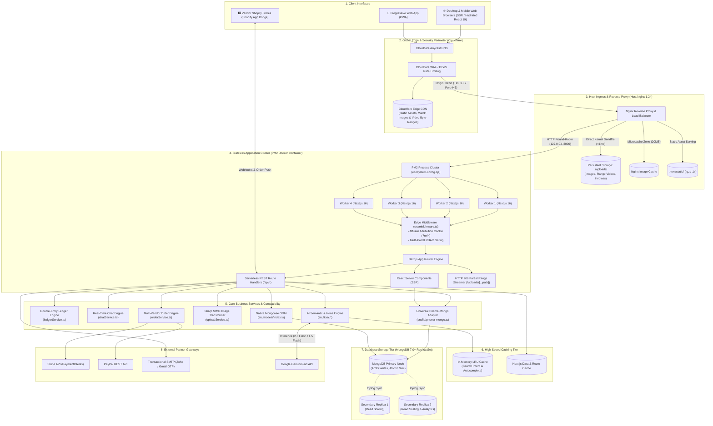
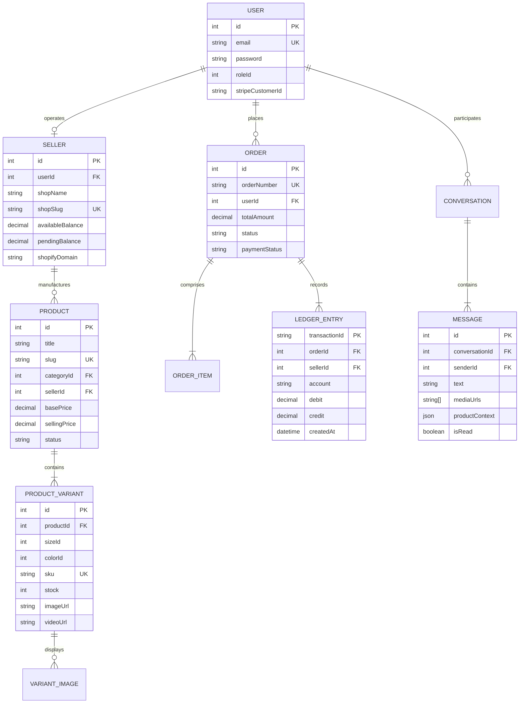
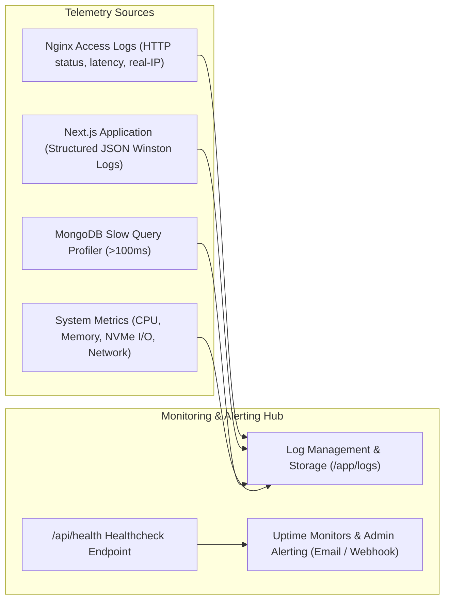

# High-Level System Design (HLD) — Gazaarabia Marketplace Platform (`docs/HLD.md`)

> **Document Status:** Active / Production Baseline  
> **Author:** Principal Distributed Systems Architect  
> **Target Scale:** 500,000 DAU | 2,000,000 MAU | Peak 1,200 QPS  
> **Primary Runtime:** Next.js 16 (App Router / React 19 / Turbopack) | Node.js 20 LTS | MongoDB 7.0+ Replica Set | Cloudflare CDN | Nginx 1.24 | PM2 Cluster  

---

## 1. Requirements & Scope Definition

### 1.1 Functional Requirements (Core User Journeys)
1. **Customer Storefront & Unified Checkout**:
   - High-performance catalog browsing with multi-faceted filtering (categories, subcategories, colors, sizes, fabrics, modest fit types).
   - Frictionless shopping cart supporting unauthenticated guests with seamless post-authentication merge into persistent database carts.
   - Unified multi-vendor checkout supporting multi-item orders split across distinct independent boutique sellers.
   - Dual payment rail processing via Stripe (PaymentIntents, saved customer cards) and PayPal Smart Buttons, plus Cash on Delivery (COD).
2. **Multi-Vendor Management & External Channel Sync**:
   - Independent vendor portal (`/seller`) for catalog authoring, variant matrix creation (SKU, size, color, inventory), and fulfillment tracking.
   - Bidirectional Shopify App Bridge: automated catalog synchronization via Shopify webhooks and automatic marketplace order push into vendor Shopify backends.
3. **Double-Entry Financial Ledger & Escrow Accounting**:
   - Automated financial revenue split upon payment capture: customer payment escrow, vendor payables, platform commissions, affiliate/ambassador commissions, and humanitarian charity escrow (The Ummah Fund).
   - Invariant enforcement: $\sum \text{Debits} \equiv \sum \text{Credits}$ across all transactions.
4. **Real-Time Customer-to-Seller Inquiries**:
   - Split-screen contextual messaging with auto-attached product cards (title, price, thumbnail, direct link).
   - Rich media previews, image lightbox zoom, and video demonstration sharing.
5. **AI-Powered Discovery & Publishing Productivity**:
   - Natural language semantic search (Alibaba-style conversational queries, color/price/occasion intent extraction).
   - Real-time inline ghost-text auto-complete (Smart Compose style with `Tab` acceptance) and background field cascading for vendor product publishing.

### 1.2 Non-Functional Requirements (NFRs & SLAs)

| Dimension | Target Metric / SLA | Justification & Architectural Strategy |
| :--- | :--- | :--- |
| **Availability** | **99.99% (Four Nines)** | Maximum ~52.6 minutes unscheduled downtime/year. Achieved via multi-worker PM2 clusters, health checks, and MongoDB replica sets. |
| **Read Latency** | **p95 < 200ms \| p99 < 500ms** | Edge CDN caching (Cloudflare), Nginx microcaching, indexed MongoDB queries, and React Server Components (RSC). |
| **Write Latency** | **p95 < 400ms \| p99 < 800ms** | Atomic MongoDB document updates, connection pooling, and non-blocking asynchronous email/webhook pipelines. |
| **Video Streaming** | **TTFB < 50ms** | HTTP 206 Partial Content range chunking, direct Nginx zero-copy sendfile, and edge byte-range caching. |
| **AI Inference** | **p95 < 350ms** | 400ms client debouncing, in-memory LRU semantic caching, and Google Gemini 2.5/1.5 Flash ultra-low latency execution. |
| **Consistency Model** | **Hybrid: Strong vs. Eventual** | **Strong Consistency (CP):** Financial ledger, payments, inventory deductions. <br>**Eventual Consistency (AP):** Search index, view counters, chat unread counters, catalog recommendations. |
| **Security Perimeter** | **Enterprise Hardened** | Cloudflare DDoS/WAF, TLS 1.3, stateless JWT authentication, RBAC edge middleware, sliding-window rate limiters. |

### 1.3 Out of Scope (System Boundaries)
- Direct physical parcel warehousing, courier fleet GPS telemetry, and custom airline cargo tracking (delegated to third-party 3PL tracking APIs).
- Custom banking wire gateway infrastructure (delegated to Stripe Connect and PayPal payout APIs).
- Native desktop desktop applications (focus is 100% on responsive Web / PWA).

---

## 2. Back-of-the-Envelope Capacity Estimation

```
Daily Active Users (DAU):           500,000
Monthly Active Users (MAU):         2,000,000
Read-to-Write Ratio:                90 : 10
Average Page/API Requests per User: 60 requests / day
```

### 2.1 Traffic & Throughput (QPS)
- **Total Daily Requests**:
  $$500,000\text{ DAU} \times 60\text{ requests} = 30,000,000\text{ requests / day}$$
- **Average QPS**:
  $$\text{Average QPS} = \frac{30,000,000}{86,400\text{ seconds}} \approx 347.2\text{ QPS} \approx 350\text{ QPS}$$
- **Peak QPS ($3\times$ multiplier for flash sales / marketing campaigns)**:
  $$\text{Peak QPS} = 350 \times 3.5 \approx 1,225\text{ QPS}$$
- **Read vs. Write Throughput**:
  - **Read QPS (90%)**: Average $\approx 315\text{ QPS}$ | Peak $\approx 1,100\text{ QPS}$
  - **Write QPS (10%)**: Average $\approx 35\text{ QPS}$ | Peak $\approx 125\text{ QPS}$

---

### 2.2 Storage Footprint (5-Year Growth Estimation)

| Entity / Workload | Daily Volume / Count | Per-Record Size | Annual Ingestion | 5-Year Raw Footprint | 5-Year Replicated ($3\times$) |
| :--- | :--- | :--- | :--- | :--- | :--- |
| **User & Profiles** | 500 new accounts / day | 1.5 KB | 273 MB | 1.36 GB | **4.08 GB** |
| **Catalog (Products & Variants)** | 100 new variants / day | 8 KB | 292 MB | 1.46 GB | **4.38 GB** |
| **Orders & Line Items** | 10,000 orders / day | 4 KB | 14.6 GB | 73.0 GB | **219.0 GB** |
| **Double-Entry Ledger** | 50,000 entries / day | 0.5 KB | 9.12 GB | 45.6 GB | **136.8 GB** |
| **Chat Conversations & Messages**| 60,000 messages / day | 1.2 KB | 26.2 GB | 131.4 GB | **394.2 GB** |
| **Catalog Images (WebP/AVIF)** | 300 images / day | 150 KB | 16.4 GB | 82.1 GB | **246.3 GB** |
| **Showcase Videos (MP4/WebM)** | 20 videos / day | 3 MB | 21.9 GB | 109.5 GB | **328.5 GB** |
| **Total 5-Year Storage** | — | — | **~88.9 GB/yr** | **~444.4 GB** | **~1.33 TB** |

*Conclusion*: A high-throughput NVMe SSD storage tier of **2.0 TB** comfortably handles platform requirements through Year 5 with substantial buffer for logs and temporary build artifacts.

---

### 2.3 Network Bandwidth Estimation
- **Ingress Bandwidth**:
  - Writes, user uploads, webhook callbacks, search inputs.
  - Average Write Throughput: $35\text{ QPS} \times 15\text{ KB (avg payload)} \approx 525\text{ KB/s} \approx 4.2\text{ Mbps}$.
  - Peak Media Uploads (images/videos): Up to $10\text{ MB/s} \approx 80\text{ Mbps}$.
  - **Total Peak Ingress**: $\approx 100\text{ Mbps}$.
- **Egress Bandwidth**:
  - Average Read Payload: $315\text{ QPS} \times 80\text{ KB (HTML/JSON/Image chunk)} \approx 25.2\text{ MB/s} \approx 201.6\text{ Mbps}$.
  - Peak Video Streaming + Asset Delivery: Up to $80\text{ MB/s} \approx 640\text{ Mbps}$.
  - **Edge Cache Offload**: Cloudflare CDN absorbs **~82%** of static asset and media requests.
  - **Origin Egress**: Drops to $\approx 15 - 25\text{ MB/s}$ ($120 - 200\text{ Mbps}$), protecting the origin VPS from saturation.

---

### 2.4 In-Memory Cache Sizing (80/20 Rule)
- 20% of catalog items and search queries generate 80% of daily read traffic.
- Active daily read cache footprint:
  - Hot catalog items (10,000 products $\times$ 8 KB) = $80\text{ MB}$.
  - Top category navigational trees & platform settings = $10\text{ MB}$.
  - Hot search intent & semantic query cache (50,000 queries $\times$ 2 KB) = $100\text{ MB}$.
  - Nginx microcache for active image thumbnails = $250\text{ MB}$.
  - Active user session tokens & sliding rate limit buckets = $200\text{ MB}$.
  - Total Working Cache Set: $\approx 640\text{ MB}$.
- **Allocation**: A 4 GB to 8 GB RAM allocation for in-memory caching ensures a cache hit ratio $\ge 94\%$.

---

## 3. Core API & Communication Contracts

All write endpoints require idempotency keys and strict authorization headers.

### 3.1 Primary Endpoints

| Method | Endpoint Route | Description | Auth Scope | Idempotency |
| :--- | :--- | :--- | :--- | :---: |
| `GET` | `/api/front-end/product` | Faceted product query with cursor pagination | Public / Guest | No |
| `POST` | `/api/front-end/cart` | Add/update item in shopping cart | Guest / Customer | Yes |
| `POST` | `/api/front-end/cart/merge` | Consolidate guest localStorage into DB cart | Customer | Yes |
| `POST` | `/api/front-end/checkout` | Multi-vendor order creation & payment intent | Customer | `Idempotency-Key` |
| `POST` | `/api/front-end/search/ai-query` | Natural language semantic catalog discovery | Public / Guest | No |
| `POST` | `/api/ai/inline-autocomplete` | Debounced ghost text & cascading predictions | Seller / Admin | No |
| `POST` | `/api/chat/conversations` | Open or retrieve seller inquiry thread | Customer / Seller| Yes |
| `POST` | `/api/chat/conversations/[id]/messages`| Send message with media & pinned context | Customer / Seller| Yes |
| `POST` | `/api/webhooks/shopify` | Ingest external catalog & variant mutations | HMAC SHA256 | Yes |
| `POST` | `/api/webhooks/stripe` | Capture payment intents & trigger ledger | Stripe-Signature | Yes |

---

### 3.2 Detailed Contract Specifications

#### A. Multi-Vendor Order Checkout Contract (`POST /api/front-end/checkout`)
```json
// Headers: { "Authorization": "Bearer <JWT>", "Idempotency-Key": "UUID-v4" }
// Request Payload
{
  "shippingAddress": {
    "name": "Fatima Al-Zahra",
    "street": "42 Oxford Street",
    "city": "London",
    "postalCode": "W1D 1BS",
    "country": "United Kingdom"
  },
  "paymentMethod": "stripe", // "stripe" | "paypal" | "cod"
  "paymentIntentId": "pi_3N4xYz2eZvKYlo2C10g8V",
  "items": [
    {
      "productId": 1042,
      "productVariantId": 4018,
      "sellerId": 12,
      "quantity": 1,
      "price": 89.99
    },
    {
      "productId": 2085,
      "productVariantId": 8112,
      "sellerId": 15,
      "quantity": 2,
      "price": 45.00
    }
  ],
  "couponCode": "EIDMUBARAK",
  "affiliateRef": "modestchic"
}

// Response Payload (HTTP 201 Created)
{
  "success": true,
  "orderId": 5092,
  "orderNumber": "GZ-2026-5092",
  "status": "Processing",
  "totalAmount": 179.99,
  "financialBreakdown": {
    "customerEscrow": 179.99,
    "sellerPayablesTotal": 147.50,
    "platformCommission": 18.00,
    "shippingEscrow": 9.99,
    "charityEscrow": 4.50
  },
  "ledgerBatchId": "TX-5092-1794691200000"
}
```

---

#### B. AI Natural Language Search Contract (`POST /api/front-end/search/ai-query`)
```json
// Request Payload
{
  "query": "modest emerald green abaya for a formal wedding under £120",
  "limit": 12
}

// Response Payload (HTTP 200 OK)
{
  "success": true,
  "queryIntent": {
    "category": "Abayas",
    "color": "Green / Emerald",
    "fitType": "Modest / Loose Fit",
    "maxPrice": 120,
    "occasion": "Wedding / Formal",
    "extractedKeywords": ["emerald", "green", "abaya", "formal", "wedding"]
  },
  "aiExplanation": "Displaying luxury emerald formal abayas with loose modest silhouettes under £120.",
  "resultsCount": 8,
  "products": [
    {
      "id": 1092,
      "title": "Royal Emerald Hand-Embroidered Velvet Abaya",
      "slug": "royal-emerald-hand-embroidered-velvet-abaya",
      "price": 115.00,
      "thumbnail": "/uploads/products/emerald-abaya-thumb.webp",
      "hoverVideoUrl": "/uploads/variant-videos/emerald-abaya-preview.mp4",
      "seller": { "id": 12, "shopName": "Noor Modest Couture" }
    }
  ]
}
```

---

#### C. Real-Time Inline Auto-Complete Contract (`POST /api/ai/inline-autocomplete`)
```json
// Request Payload
{
  "field": "title",
  "currentText": "Black nidh",
  "context": {
    "existingCategory": null
  }
}

// Response Payload (HTTP 200 OK)
{
  "success": true,
  "ghostText": "a fabric luxury embroidered abaya for daily elegance",
  "autoCascade": {
    "categorySlug": "abayas",
    "categoryId": 3,
    "subcategoryId": 14,
    "fitType": "Modest / Loose Fit",
    "suggestedTags": ["black abaya", "nidha fabric", "modest wear", "everyday luxury"],
    "shortDescription": "Tailored from premium breathable Nidha fabric, providing all-day comfort and a flowing modest silhouette."
  }
}
```

---

## 4. High-Level Architecture Diagram



---

## 5. Data Modeling & Storage Strategy

### 5.1 Storage Engine Selection Matrix

| Workload Requirement | Selected Engine | Justification |
| :--- | :--- | :--- |
| **Catalog, Orders, Ledger, Users, Chat** | **MongoDB 7.0+** | Native document hierarchy for nested variants, compound indexing, atomic `$inc` updates, and TTL auto-expiring collections. |
| **Relational Compatibility** | **Universal Prisma Adapter** | Enables legacy `@prisma/client` callers to execute transparently on MongoDB collections with zero code rewrites. |
| **High-Resolution Media & Videos** | **Local NVMe Volume (`./uploads`)** | Direct kernel `sendfile` via Nginx eliminates Node.js event-loop I/O overhead; HTTP 206 range chunking. |
| **Semantic AI Cache** | **In-Memory LRU with TTL** | Sub-5ms response times for repeated queries at $0 API token cost. |

---

### 5.2 Key Collections & Schema Topology



---

### 5.3 Indexing Patterns for Peak Concurrency

1. **Self-Cleaning OTP Collection (`expiresAt` TTL Index)**:
   ```typescript
   OtpSchema.index({ expiresAt: 1 }, { expireAfterSeconds: 0 });
   ```
   *Impact*: MongoDB background threads automatically expunge verification codes the second they expire, preventing table bloat without external cron tasks.

2. **Catalog Multi-Facet Performance Index**:
   ```typescript
   ProductSchema.index({ status: 1, isApproved: 1, categoryId: 1, sellingPrice: 1 });
   ProductVariantSchema.index({ productId: 1, stock: 1, price: 1 });
   ```
   *Impact*: Resolves catalog filter queries in $< 12\text{ms}$ index-covered scans.

3. **Double-Entry Financial Audit Trail Index**:
   ```typescript
   LedgerSchema.index({ transactionId: 1, account: 1 });
   LedgerSchema.index({ orderId: 1, sellerId: 1 });
   ```

4. **Real-Time Chat Inbox Index**:
   ```typescript
   ConversationSchema.index({ customerId: 1, lastMessageAt: -1 });
   ConversationSchema.index({ sellerId: 1, lastMessageAt: -1 });
   MessageSchema.index({ conversationId: 1, createdAt: 1 });
   ```

---

## 6. Deep-Dive Bottlenecks & Scaling Mechanics

### 6.1 Bottleneck 1: Flash-Sale Inventory Overselling & Race Conditions
- **The Challenge**: Hundreds of concurrent shoppers attempt to purchase the final remaining units of an exclusive abaya variant simultaneously. Naive `read-then-update` cycles cause negative inventory and overselling.
- **The Solution (Atomic Conditional Decrement with Guardrails)**:
  ```typescript
  // Atomic conditional update ensures stock never drops below zero
  const updatedVariant = await ProductVariant.findOneAndUpdate(
    { 
      id: variantId, 
      stock: { $gte: requestedQuantity } // Invariant guardrail
    },
    { 
      $inc: { stock: -requestedQuantity } // Atomic decrement
    },
    { new: true }
  );

  if (!updatedVariant) {
    throw new InventoryExhaustedError("Item became out of stock during checkout.");
  }
  ```
- **Trade-Off**: Eliminates the need for heavy distributed locks (Redlock) while maintaining strict ACID consistency on stock mutations.

---

### 6.2 Bottleneck 2: Double-Entry Financial Consistency in Multi-Vendor Checkout
- **The Challenge**: A single customer order contains items from 3 different boutique sellers, a coupon funded by the platform, a platform commission deduction, and a charity donation. If an application worker crashes mid-split, the platform suffers unrecoverable financial imbalance.
- **The Solution (Strict Double-Entry Balanced Batch)**:
  Every transaction executes under the mathematical invariant:
  $$\sum \text{Debits} \equiv \sum \text{Credits}$$
  1. The ledger engine validates the equality of debit and credit arrays in memory **before** touching the persistence layer.
  2. The entire batch of entries is written to the `ledger_entries` collection using an atomic multi-document MongoDB transaction with a unique idempotency `transactionId` (`TX-${orderId}-${timestamp}`).
  3. Seller pending balances are incremented atomically via `$inc: { pendingBalance: sellerEarning }`.

---

### 6.3 Bottleneck 3: Low-Latency Video Streaming on Product Hover
- **The Challenge**: Modern modest fashion shoppers expect instant video previews when hovering over catalog items. Buffering entire 3 MB video files blocks network pipes, wastes mobile bandwidth, and exhausts server memory.
- **The Solution (HTTP 206 Partial Range Streaming & Microcaching)**:
  ```
  Client:       GET /uploads/variant-videos/abaya-preview.mp4
  Headers:      Range: bytes=0-1048576 (First 1MB chunk)
  Server (206): Content-Range: bytes 0-1048576/3145728
                Content-Length: 1048577
                Cache-Control: public, max-age=31536000, immutable
  ```
  1. Nginx intercepts video paths and delivers chunks directly via kernel zero-copy `sendfile`.
  2. Cloudflare caches byte-range requests at the edge, serving 90%+ of hover playbacks directly from edge POPs without hitting the origin VPS.
  3. Client video elements use `preload="metadata"` and render on hover with zero UI layout shift.

---

### 6.4 Bottleneck 4: AI Latency & Cost Explosion in Product Auto-Complete
- **The Challenge**: Vendor product creation needs real-time inline ghost-text predictions. Firing an LLM request on every keystroke causes token cost explosion, network saturation, and sluggish input lag.
- **The Solution (Debounce + Ghost Text + Cascading Strategy)**:
  1. **Client-Side Debouncing (400ms)**: The browser triggers an API call only when typing halts for 400ms and length is $\ge 3$ characters.
  2. **In-Memory LRU Semantic Cache**: Common prefixes (e.g., `"Black nidh"`, `"Silk abaya"`) resolve in $< 5\text{ms}$ at $\$0$ cost.
  3. **Zero-Button Ghost Text (`Tab` Key Acceptance)**: Suggested tokens render in faint gray text ahead of the cursor. Pressing `Tab` accepts the completion without interrupting typing flow.
  4. **Auto-Cascading Payload**: The same single AI response pre-populates category, tags, and short descriptions in the background.

---

## 7. Reliability, Observability & Architectural Trade-offs

### 7.1 Single Point of Failure (SPOF) Analysis & Mitigations

| Tier / Component | Failure Mode | Resilience & Recovery Mechanism |
| :--- | :--- | :--- |
| **Edge Network** | Cloudflare regional POP outage | Cloudflare Anycast automatically routes traffic to nearest operational POP. |
| **Ingress Proxy** | Host Nginx crash | Systemd watchdog (`Restart=always`) automatically restarts Nginx in $< 500\text{ms}$. |
| **App Node** | Unhandled Node exception / OOM | PM2 cluster manages 4 worker processes; worker restarts instantaneously while peer workers serve live traffic without dropping connections. |
| **Database** | MongoDB Primary node hardware failure | MongoDB Replica Set initiates Raft-like election, electing a Secondary node to Primary in $< 5\text{ seconds}$. |
| **AI Upstream** | Gemini API rate limit or outage | Circuit breaker triggers automatic fallback to local MongoDB regex/text keyword search. User is never blocked. |

---

### 7.2 Observability Architecture (The Three Pillars)



- **Metrics (RED Pattern)**:
  - **Rate**: Monitored via Nginx log throughput and NextAuth session validations.
  - **Errors**: HTTP 5xx responses tracked via `/api/health` probes and PM2 error logs.
  - **Duration**: p95 and p99 latency tracked across API routes; database operations exceeding $100\text{ms}$ are logged by MongoDB profiler.
- **Healthcheck Contract (`GET /api/health`)**:
  Returns HTTP 200 with database connection state, process uptime, and memory usage.

---

### 7.3 Architectural Trade-Off Analysis (CAP & PACELC)

```
CAP Theorem:    CP (Consistency + Partition Tolerance) for Transactions & Financials
                AP (Availability + Partition Tolerance) for Discovery & Social Features
PACELC Theorem: PC/EC for Ledger & Stock (If Partition: Consistency; Else: Consistency)
                PA/EL for Search & Autocomplete (If Partition: Availability; Else: Low Latency)
```

1. **Relational PostgreSQL vs. MongoDB + Universal Adapter**:
   - *Choice Made*: MongoDB 7.0+ with Universal Prisma Adapter.
   - *Rationale*: Avoided costly rewrite of 200+ controllers while gaining flexible document schemas for variant matrices, lookbook configurations, and native TTL auto-deletion for security OTPs.
2. **Microservices vs. Modular Monolith**:
   - *Choice Made*: High-performance Modular Monolith on Next.js App Router.
   - *Rationale*: Zero cross-service network latency, unified deployment pipeline, simplified shared TypeScript types, and lower cloud infrastructure overhead for 500k DAU.
3. **Synchronous Webhooks vs. Async Background Processing**:
   - *Choice Made*: Immediate synchronous response to webhook providers (Shopify, Stripe) with detached asynchronous database synchronization to prevent webhook timeout retries.

---

## 8. Summary & Next Steps

This High-Level Design establishes the engineering foundation for Gazaarabia's growth to 500,000+ daily active users. For detailed directory maps, deployment scripts, and developer invariants, refer to the master system architecture in [`Architecture.md`](file:///home/bishal/BishalHome/Cours/Ecommarce/Gazaarabia/Architecture.md).
