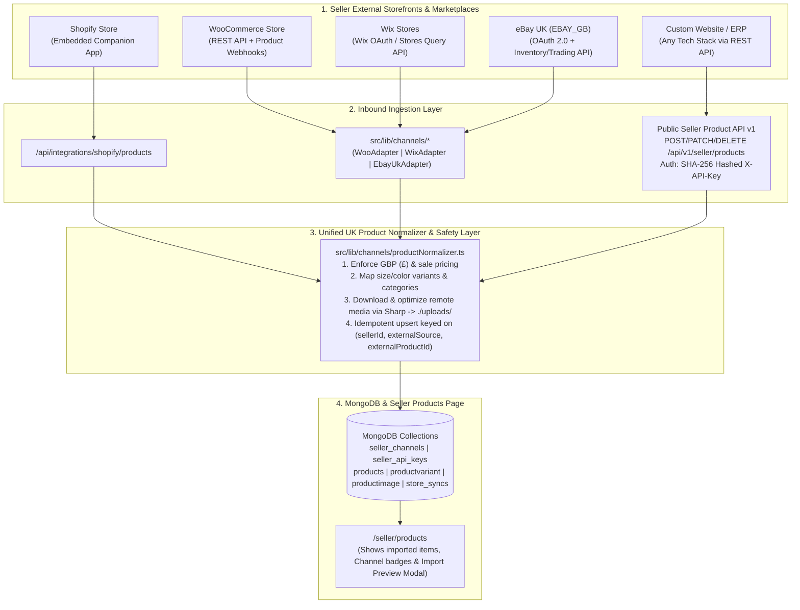

# Multi-Channel Seller Product Import & Custom API Integration Blueprint (`docs/MULTI_CHANNEL_PRODUCT_IMPORT_PLAN.md`)

> **Document Class:** Feature Architecture & Implementation Specification  
> **Target Marketplace:** Gazaarabia UK (`https://gazaarabia.com` | Primary Currency: `GBP £`)  
> **Supported Platforms:** Shopify (Existing Companion App), WooCommerce (Existing REST + Variant Upgrade), Wix Stores, eBay UK (`EBAY_GB`), and Seller Custom REST API (`X-API-Key`)  
> **Integration Scope:** **Strict One-Way Inbound Import & Catalog Sync** (External Storefronts $\rightarrow$ Gazaarabia). Outbound order push and reverse stock updates back to external websites are **explicitly excluded**.

---

## 1. Purpose, Scope & Current Codebase Baseline

UK boutique modest-wear sellers already maintain product catalogs across external storefronts and marketplaces. This document specifies how sellers connect those external platforms—or push products directly from their own custom websites/ERPs—so products, variants, quantities, and images are **imported cleanly into their Gazaarabia Seller Products Page** (`/seller/products`).

### 1.1 Explicit Boundaries (What Is In Scope vs. Out of Scope)
* **In Scope (Inbound Catalog Sync):**
  * Connecting external stores (**Shopify**, **WooCommerce**, **Wix Stores**, **eBay UK**) or authenticating via **Gazaarabia Seller Custom API (`X-API-Key`)**.
  * Importing & updating product titles, HTML descriptions, `GBP (£)` prices, variants (Size/Color/SKU), initial stock counts, and local WebP-mirrored images into Gazaarabia.
  * Scheduled / manual incremental refreshes (`External Store -> Gazaarabia`) so newly added products or updated prices/stock on the external site appear on Gazaarabia.
* **Out of Scope (Explicitly Excluded per Requirements):**
  * **No Outbound Order Push:** Paid customer orders on Gazaarabia are handled and fulfilled natively inside Gazaarabia (`/seller/orders`) and are **never pushed back** to Shopify, WooCommerce, Wix, eBay UK, or a seller's custom website.
  * **No Reverse Stock Sync Back:** When a customer buys an item on Gazaarabia, Gazaarabia deducts its own local stock via [`stockHelper.ts`](file:///home/bishal/BishalHome/Cours/Ecommarce/Gazaarabia/src/lib/helpers/stockHelper.ts) without calling external stores to decrement stock or fire outbound order webhooks.

### 1.2 Existing Sync Capabilities vs. Planned Upgrades

| Platform | Current Codebase State | Gaps Identified | Planned Upgrade (Inbound Only) |
| :--- | :--- | :--- | :--- |
| **Shopify** | Implemented via [`shopify-app/`](file:///home/bishal/BishalHome/Cours/Ecommarce/Gazaarabia/shopify-app/README.gazaarabia.md) (GraphQL + OAuth), [`/api/integrations/shopify/products`](file:///home/bishal/BishalHome/Cours/Ecommarce/Gazaarabia/src/app/api/integrations/shopify/products/route.ts), [`shopifyVariantSync.ts`](file:///home/bishal/BishalHome/Cours/Ecommarce/Gazaarabia/src/lib/services/shopifyVariantSync.ts) | Single `seller.storeType` prevents connecting multiple platforms; remote Shopify CDN images are not mirrored locally to `./uploads/products/`. | Coexist inside multi-channel `seller_channels`; mirror remote images locally via Sharp; display source badge & resync action on `/seller/products`. *(Outbound `shopifyOrderPush.ts` is not extended.)* |
| **WooCommerce** | Implemented via [`storeHelper.ts`](file:///home/bishal/BishalHome/Cours/Ecommarce/Gazaarabia/src/lib/storeHelper.ts), [`syncEngine.ts`](file:///home/bishal/BishalHome/Cours/Ecommarce/Gazaarabia/src/lib/syncEngine.ts), [`/api/seller/store/connect`](file:///home/bishal/BishalHome/Cours/Ecommarce/Gazaarabia/src/app/api/seller/store/connect/route.ts) | `fetchWooProducts()` imports only top-level `sellingPrice`/`baseQty` instead of variable size/color variations; `wooConsumerSecret` stored unencrypted. | Fetch `/wp-json/wc/v3/products/{id}/variations` for variable items; reconcile variants uniformly; encrypt secrets at rest; add inbound `product.created`/`product.updated` webhook support. |
| **Wix Stores** | Not yet implemented | Sellers on Wix cannot import catalogs into Gazaarabia. | Build `wixAdapter.ts` (OAuth 2.0 / API Key + Wix Stores Query API + inbound product-change webhook `/api/webhooks/wix`). |
| **eBay UK (`EBAY_GB`)** | Not yet implemented | UK eBay sellers must manually re-create listings on Gazaarabia. | Build `ebayUkAdapter.ts` (eBay OAuth 2.0 for `ebay.co.uk`, Inventory & Trading API import, and mandatory account-deletion compliance endpoint). |
| **Custom Website API** | Not yet implemented | Sellers with custom Node/Laravel/Magento/ERP sites have no API key to push products into Gazaarabia. | Build `/api/v1/seller/products/*` (`X-API-Key` auth for `POST`, `GET`, `PATCH`, `DELETE` product sync into Gazaarabia). |
| **Seller UI** | [`StoreConnect.tsx`](file:///home/bishal/BishalHome/Cours/Ecommarce/Gazaarabia/src/components/seller/StoreConnect.tsx) handles WooCommerce only; [`seller/products/page.tsx`](file:///home/bishal/BishalHome/Cours/Ecommarce/Gazaarabia/src/app/seller/(dashboard)/products/page.tsx) has only `"Create Product"`. | No multi-channel hub, no `"Import / Sync Store"` modal on Products page, no API key panel, no channel origin badges. | Upgrade UI to 5-channel inbound hub + `"Import from Store / API"` modal & source filter on `/seller/products`. |

---

## 2. End-to-End One-Way Inbound Architecture

All 5 ingestion paths flow **strictly in one direction** through a shared UK Product Normalizer into Gazaarabia's catalog database:



---

## 3. Data Model Upgrades (MongoDB Collections)

To allow a single UK seller to connect **multiple external stores simultaneously** (e.g., eBay UK + Wix + Custom API), decouple channel credentials from the single `sellers.storeType` column while retaining backward compatibility:

### 3.1 `seller_channels` Collection
| Field | Type | Purpose |
| :--- | :--- | :--- |
| `id` | `Number` (auto-inc, unique) | Channel connection primary ID. |
| `sellerId` | `Number` (indexed) | Foreign key to `sellers.id`. |
| `channelType` | `String` | `"shopify" \| "woocommerce" \| "wix" \| "ebay_uk"`. |
| `accountLabel` | `String` | Friendly name shown in UI (e.g., `"UK Boutique eBay Store"`). |
| `externalShopId` | `String` | Shopify shop domain, Wix `siteId`, Woo URL, or eBay `username/userId`. |
| `encryptedCredentials` | `String` | AES-256-GCM encrypted JSON (`accessToken`, `refreshToken`, `expiresAt`, `consumerKey`, `consumerSecret`). |
| `webhookSecret` | `String` | Per-channel HMAC verification secret for inbound product webhooks. |
| `defaultImportActive` | `Boolean` | `true` = publish live immediately; `false` = import as Draft for review. |
| `lastSyncedAt` | `Date` | Cursor watermark for incremental inbound catalog refreshes. |
| `isActive` | `Boolean` | Allows pausing sync without deleting already-imported products. |

### 3.2 `seller_api_keys` Collection (Custom API Auth)
| Field | Type | Purpose |
| :--- | :--- | :--- |
| `id` | `Number` | Key ID. |
| `sellerId` | `Number` (indexed) | Owner seller ID. |
| `name` | `String` | Key label (e.g., `"Custom Website Sync"`). |
| `keyPrefix` | `String` | First 12 chars (`"ga_live_8c4a"`) displayed in UI for identification. |
| `keyHash` | `String` (unique index) | SHA-256 hash of full API key (raw secret is shown once at creation). |
| `scopes` | `String[]` | Strictly product catalog scopes: `["products:read", "products:write"]`. |
| `lastUsedAt` | `Date` | Audit timestamp of most recent API request. |
| `isActive` | `Boolean` | Instant revocation switch. |

### 3.3 Compound Index on `products` & `productvariant`
* `products`: `{ sellerId: 1, externalSource: 1, externalProductId: 1 }` (ensures a seller importing ID `"12345"` from both Wix and eBay UK creates two distinct items without overwriting).
* `productvariant`: `{ productId: 1, externalVariantId: 1 }` (generalizes the identity matching already used in `shopifyVariantSync.ts` across WooCommerce, Wix, eBay UK, and Custom API).

---

## 4. Platform-by-Platform Inbound Import Mechanics

### 4.1 Shopify (Existing Companion App — Enhanced)
* **How Seller Connects:** Installs the Gazaarabia app from Shopify Admin $\rightarrow$ completes OAuth in [`shopify-app/`](file:///home/bishal/BishalHome/Cours/Ecommarce/Gazaarabia/shopify-app/README.gazaarabia.md) $\rightarrow$ links account via `/shopify/connect`.
* **How Products Enter Gazaarabia:** `shopify-app` runs paginated GraphQL `PRODUCTS_QUERY` (plus inbound `products/update` and `products/delete` webhooks) and calls `/api/integrations/shopify/products` signed with `x-internal-secret`.
* **Upgrade:** Pass remote Shopify image URLs through `mediaMirrorService.ts` so product images persist locally in `./uploads/products/`, and register the Shopify link inside `seller_channels`.

### 4.2 WooCommerce (Existing REST Sync — Variant Upgrade)
* **How Seller Connects:** Enters WordPress `siteUrl`, `consumerKey`, and `consumerSecret` in `/seller/integrations` (stored encrypted in `seller_channels`).
* **How Products Enter Gazaarabia:**
  1. `wooAdapter.ts` queries `GET /wp-json/wc/v3/products?per_page=100&page=N`.
  2. **Variant Upgrade:** When `p.type === "variable"`, fetches `GET /wp-json/wc/v3/products/{p.id}/variations?per_page=100`, mapping size/color attributes, SKUs, sale/regular GBP prices, and stock into `NormalizedExternalVariant[]`.
  3. **Inbound Product Webhooks (Optional Real-Time):** Expand `/api/webhooks/woocommerce` (verifying `x-wc-webhook-signature`) to process `product.created` and `product.updated` payloads so new WooCommerce items appear immediately without waiting for cron.

### 4.3 Wix Stores (New Integration)
* **How Seller Connects:**
  * Option A: **"Connect Wix Store"** OAuth 2.0 flow storing refreshable tokens in `seller_channels`.
  * Option B: Seller pastes Wix **Site ID** + **API Key** directly in `/seller/integrations`.
* **How Products Enter Gazaarabia:**
  * Pull catalog via `POST https://www.wixapis.com/stores/v1/products/query` (paginated, `{ includeVariants: true }`).
  * Map Wix fields (`name`, `description`, `priceData.price`, `priceData.discountedPrice`, `variants[].choices` for Size/Color, `stock.quantity`, `media.items[].image.url`).
  * Optional inbound webhook endpoint `POST /api/webhooks/wix?sellerId=...` verifying Wix signature to import new/edited Wix products automatically.

### 4.4 eBay UK (`EBAY_GB` — New Integration)
* **How Seller Connects:** Clicks **"Connect eBay UK Account"** $\rightarrow$ redirects to eBay OAuth (`https://auth.ebay.com/oauth2/authorize` with read-only inventory/seller scopes) $\rightarrow$ callback exchanges authorization code for Access/Refresh tokens encrypted in `seller_channels`.
* **How Products Enter Gazaarabia:**
  * Supports **two eBay UK listing sources** (so all UK eBay sellers work seamlessly regardless of how they create listings):
    1. **eBay Inventory API (`GET /sell/inventory/v1/inventory_item` + `/offer?marketplace_id=EBAY_GB`)** for modern API listings.
    2. **eBay Trading API (`GetMyeBaySelling` / `GetItem`)** so listings created manually in eBay UK Seller Hub (`ebay.co.uk`) also import cleanly.
  * Maps GBP (`£`) prices, multi-variation items (`Variations.Variation[]`), UK item specifics (`Brand`, `Size`, `Colour`, `Department`, `Material`), and `i.ebayimg.com` gallery URLs.
* **Mandatory eBay Compliance:** Add `GET` & `POST` `/api/webhooks/ebay/account-deletion` handling eBay's SHA-256 `challengeCode` verification requirement required to obtain eBay Production keys.

### 4.5 Seller Custom Public REST API (`/api/v1/seller/products/*` — New Integration)
Any seller running a bespoke website (Laravel, Magento, Squarespace export, custom Node/Python backend, or spreadsheet/ERP script) can push products straight into their Gazaarabia Seller Products list programmatically:

* **Authentication:** Request header `X-API-Key: ga_live_...` verified against `seller_api_keys.keyHash` + rate-limited via [`src/lib/rateLimit.ts`](file:///home/bishal/BishalHome/Cours/Ecommarce/Gazaarabia/src/lib/rateLimit.ts).
* **Product-Only Endpoints (Strictly Inbound):**

| Method | Endpoint | Purpose |
| :--- | :--- | :--- |
| `POST` | `/api/v1/seller/products` | Upsert single product or batch (up to 50 items) keyed by seller's `externalProductId`. Validates GBP price, images, categories, and variants via Zod. |
| `GET` | `/api/v1/seller/products` | List the seller's Gazaarabia products, IDs, SKUs, and current status. |
| `PATCH` | `/api/v1/seller/products/[externalId]` | Lightweight update (e.g., update `sellingPrice`, `discountPrice`, `active`, or variant stock) without re-sending images or full HTML. |
| `DELETE` | `/api/v1/seller/products/[externalId]` | Soft-deactivate / archive product (`active: false, isDeleted: true`). |

* **Example Custom API Request (`POST /api/v1/seller/products`):**
```json
{
  "externalProductId": "SKU-UK-ABAYA-901",
  "title": "Black Nidha Pleated Open Abaya with Matching Sheila",
  "categorySlug": "abayas",
  "shortDescription": "Lightweight flowing UK Nidha open abaya with wide cuffs.",
  "description": "<p>Hand-finished modest open abaya tailored for effortless everyday drape.</p>",
  "currency": "GBP",
  "sellingPrice": 68.00,
  "discountPrice": 59.00,
  "active": true,
  "images": [
    "https://seller-store.co.uk/media/abaya-front.jpg",
    "https://seller-store.co.uk/media/abaya-side.jpg"
  ],
  "variants": [
    {
      "externalVariantId": "SKU-UK-ABAYA-901-BLK-54",
      "sku": "ABAYA-901-BLK-54",
      "size": "54",
      "color": "Black",
      "price": 59.00,
      "stock": 14
    },
    {
      "externalVariantId": "SKU-UK-ABAYA-901-BLK-56",
      "sku": "ABAYA-901-BLK-56",
      "size": "56",
      "color": "Black",
      "price": 59.00,
      "stock": 8
    }
  ]
}
```

---

## 5. UK Marketplace Normalization & Safety Rules

1. **Strict `GBP (£)` Currency & Pricing Normalization:**
   - All imported listings map into `sellingPrice` and `discountPrice` in GBP (`£`).
   - External feeds declaring non-GBP currency (`USD`, `EUR`) are rejected with an actionable sync error unless the seller configures conversion on their channel settings.
2. **Remote Media Mirroring into `./uploads/products/`:**
   - External CDNs (`i.ebayimg.com`, `static.wixstatic.com`, merchant servers) frequently rate-limit or expire hotlinked image URLs.
   - `mediaMirrorService.ts` fetches remote image URLs (with SSRF protection blocking private IP/localhost ranges), processes them via `sharp` into WebP (`./uploads/products/...`), and tracks `externalSourceUrl` so unchanged images are never re-downloaded on future imports.
3. **Size, Color & Category Resolution:**
   - Match incoming strings (`"UK 12"`, `"L"`, `"54"`, `"Emerald"`) case-insensitively against MongoDB `sizes`, `colors`, and `categories` (`slug` or `name`), allowing uncategorized imports to be placed cleanly in `"Draft"` or auto-assigned during preview.
4. **Native Gazaarabia Inventory & Order Execution:**
   - Once products are imported into Gazaarabia, customer purchases, `stock_reservations` ([`stockHelper.ts`](file:///home/bishal/BishalHome/Cours/Ecommarce/Gazaarabia/src/lib/helpers/stockHelper.ts)), payouts, and order fulfillment execute **100% natively within Gazaarabia**.

---

## 6. Seller UI Upgrades (`/seller/products` & `/seller/integrations`)

1. **Seller Products Page ([`src/app/seller/(dashboard)/products/page.tsx`](file:///home/bishal/BishalHome/Cours/Ecommarce/Gazaarabia/src/app/seller/(dashboard)/products/page.tsx)):**
   - Add an **"Import from Store / API"** button beside **"Create Product"**.
   - Clicking opens a clean import modal where the seller selects a connected channel (**Shopify**, **WooCommerce**, **Wix**, **eBay UK**), previews external products (selecting specific items or clicking **"Import All"** and mapping to Gazaarabia categories), or copies their **Custom API Key & Endpoint** details.
   - Add a **Channel Badge** (`Manual`, `Shopify`, `WooCommerce`, `Wix`, `eBay UK`, `Custom API`) and **Channel Filter** dropdown to the product table.
2. **Apps & Integrations Page ([`src/components/seller/StoreConnect.tsx`](file:///home/bishal/BishalHome/Cours/Ecommarce/Gazaarabia/src/components/seller/StoreConnect.tsx)):**
   - Upgrade from the single WooCommerce form to a 5-card multi-channel hub: **Shopify**, **WooCommerce**, **Wix**, **eBay UK**, and **Custom Website API**.
   - Each card provides isolated **Connect / Disconnect**, **Sync Now**, **Draft vs. Live** import preference, and sync log status.
   - The **Custom Website API** card allows generating/revoking `ga_live_...` keys and provides ready-to-copy `curl` and JSON payload snippets.

---

## 7. Security & Verification Checklist

* **Security Guardrails:**
  * Encrypt external OAuth tokens & Woo/Wix/eBay secrets using `AES-256-GCM` (`CHANNEL_ENCRYPTION_KEY`).
  * Hash `seller_api_keys` with `SHA-256`; never store or display plaintext API keys after generation.
  * SSRF guard on remote image downloader (reject private `127.0.0.0/8`, `10.0.0.0/8`, `169.254.169.254` ranges and enforce max file size).
  * Constant-time HMAC verification on inbound product webhooks (`shopify`, `woocommerce`, `wix`, `ebay`).
* **Verification Plan (Post-Implementation):**
  * Run `npm run build` to verify zero TypeScript/Turbopack errors across all new routes and seller UI pages.
  * Test Custom API `POST /api/v1/seller/products`, `PATCH /api/v1/seller/products/[externalId]`, and `DELETE` endpoints via `curl`, verifying auth rejection (`401`), rate limiting (`429`), and SSRF protection.
  * Simulate WooCommerce variable product, Wix payload, and eBay UK `EBAY_GB` mock import payloads through `productNormalizer.ts` and verify idempotent MongoDB upserts (zero duplicate products or variants).
  * Verify an imported product completes checkout natively on Gazaarabia with local stock deduction and **zero outbound calls** pushed back to external stores.
