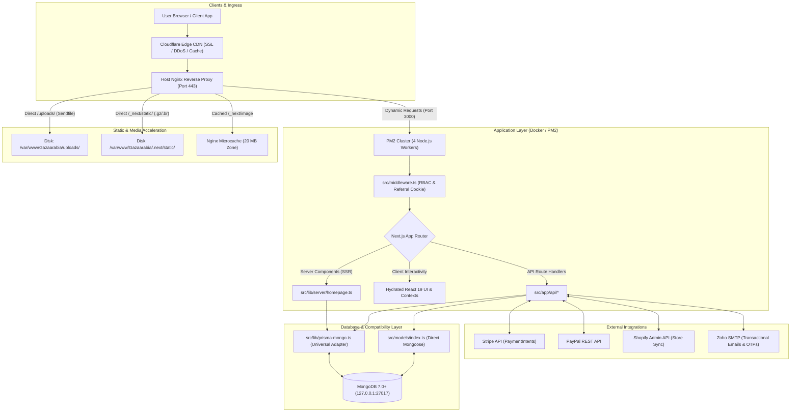
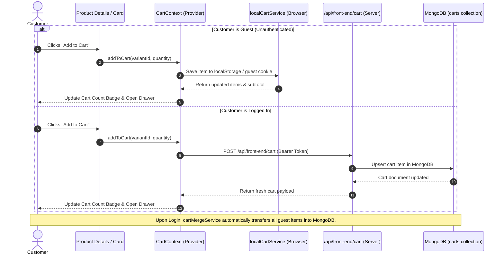
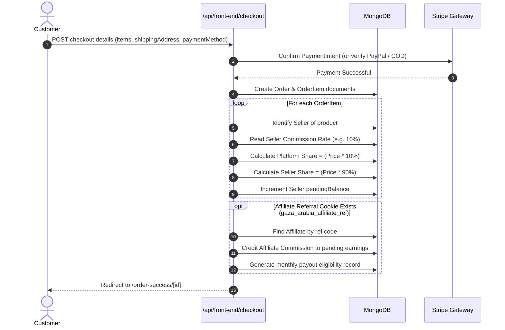

# ==============================================================================
# GAZAARABIA MARKETPLACE — COMPLETE DEVELOPER ARCHITECTURE GUIDE
# ==============================================================================
# Comprehensive Technical Reference for Full-Stack Developers & System Architects
# Framework: Next.js 16 (React 19 / Turbopack / App Router) | Runtime: Node.js 20 LTS
# Database: MongoDB 7.0+ (Mongoose 9.11 + Universal Prisma Adapter)
# Deployment: Docker Container / PM2 Cluster / Nginx Reverse Proxy / Cloudflare CDN
# ==============================================================================

## 1. Executive Summary & Technology Stack

**Gazaarabia** is a high-performance, multi-vendor modest wear and e-commerce marketplace. The platform connects consumers with modest fashion sellers, handles multi-currency transactions, calculates seller and affiliate commission splits, supports real-time customer-to-seller messaging, and integrates external seller storefronts (Shopify and WooCommerce).

### 1.1 Core Technology Stack

| Layer | Technology | Key Details & Invariants |
| :--- | :--- | :--- |
| **Framework** | **Next.js 16.2.2** | App Router, Turbopack, React 19.1.0, Server Actions, Incremental Static Regeneration (ISR). |
| **Language** | **TypeScript 5.9** | Strict type system, custom Prisma-Mongo DTO interfaces, zero runtime type errors. |
| **Database** | **MongoDB 7.0+** | Mongoose 9.11 + Universal Prisma Compatibility Adapter (`src/lib/prisma-mongo.ts`). |
| **Authentication** | **NextAuth.js v4.24** | Stateless JWT tokens, role-based access control (RBAC), auto-expiring OTP authentication. |
| **Styling & UI** | **Tailwind CSS 3.4** | Tailwind plugins (line-clamp, scrollbar), Emotion, Radix UI primitives, Lucide React, Framer Motion. |
| **State Management** | **Context + Zustand** | `CartContext` (localStorage + backend sync), Zustand modal stores (`modalStore.tsx`). |
| **Image Engine** | **Native Sharp 0.35** | SIMD-accelerated C++ `libvips` image processing, WebP/AVIF generation, zero WASM bottlenecks. |
| **Payments** | **Stripe & PayPal** | Stripe Payment Intents & Saved Cards, PayPal Smart Buttons, Cash on Delivery (COD). |
| **Process Manager** | **PM2 Cluster** | 4-worker cluster mode via `ecosystem.config.cjs` & custom `server.js`. |
| **Containerization** | **Docker Compose** | Multi-stage `node:20-slim`, `network_mode: "host"`, cgroup limits (6 Cores, 6 GB RAM). |
| **Web Server** | **Nginx 1.24** | Zero-copy kernel sendfile for `/uploads`, TLS 1.3, HTTP/2, microcaching for `/_next/image`. |

---

## 2. Codebase Structure & Directory Map

```text
Gazaarabia/
├── .dockerignore                     # Excludes node_modules, .next, .git, uploads from Docker builds
├── Dockerfile                        # Multi-stage production container with native Sharp & PM2
├── docker-compose.yml                # Isolated container configuration with cgroup limits & volume mounts
├── DOCKER_SETUP_PLAN.md              # Production containerization & multi-project isolation manual
├── ecosystem.config.cjs              # PM2 cluster configuration (4 API workers + 1 Webhook worker)
├── server.js                         # Custom HTTP server initializing Next.js with graceful shutdown
├── next.config.ts                    # Next.js configuration, @prisma/client alias, CSP, image patterns
├── package.json                      # Dependency manifests and npm script entrypoints
├── deploy/                           # Nginx virtual host configurations and Cloudflare CDN tunings
│   ├── nginx-gazaarabia.conf         # Production Nginx site block with SSL, caching, and reverse proxy
│   ├── cloudflare-ips.conf           # Cloudflare trusted proxy IP range definitions for real IP restoration
│   └── install-nginx-tuning.sh       # Automated Nginx sysctl and worker connection tuner
├── docs/                             # Developer documentation and architectural blueprints
│   ├── PROJECT_ARCHITECTURE.md       # [This Document] Primary developer and codebase guide
│   ├── concepts_brief.md             # EGM-compliant architectural ideation brief
│   └── CLOUDFLARE_CDN_SETUP.md       # Edge caching rules and DNS proxy setup guide
├── public/                           # Static public web assets (favicons, manifests, static images)
│   ├── images/                       # Fixed site graphics (logos, trust badges, payment icons)
│   └── tinymce/                      # Self-hosted TinyMCE distribution (bypasses Tiny Cloud API locks)
├── scripts/                          # Administrative, maintenance, and database scripts
│   ├── copy-tinymce.mjs              # Postinstall script copying TinyMCE assets into public/
│   ├── precompress-assets.mjs        # Postbuild script creating .gz and .br assets for Nginx static serving
│   ├── ensure-indexes.ts             # Enforces performance & TTL indexes across all MongoDB collections
│   ├── seed-fresh-products.ts        # Verified catalog seeder with strict disk image validation
│   ├── seedAdmin.js                  # Administrative account seed utility
│   ├── webhook-server.cjs            # Lightweight HMAC-verified GitHub deployment webhook listener
│   └── deploy-webhook.sh             # Webhook execution script (git pull, build, PM2 reload)
├── shopify-app/                      # Standalone companion service for Shopify App Bridge integrations
├── src/                              # Main application source directory
│   ├── middleware.ts                 # Next.js edge middleware: referral tracking & RBAC route gating
│   ├── app/                          # Next.js 16 App Router (Pages, Layouts, API Route Handlers)
│   │   ├── (site)/                   # Public marketplace customer storefront
│   │   ├── admin/                    # Platform administrator dashboard and management modules
│   │   ├── affiliate/                # Affiliate partner portal
│   │   ├── ambassador/               # Brand ambassador portal
│   │   ├── seller/                   # Seller portal, product listing, order management
│   │   ├── api/                      # 50+ REST API endpoints and third-party webhook receivers
│   │   ├── context/                  # React Context providers (CartContext, etc.)
│   │   ├── uploads/                  # Dynamic media streaming route with HTTP 206 Range support
│   │   └── layout.tsx                # Root layout with font imports, metadata, and global providers
│   ├── components/                   # Reusable React UI components
│   │   ├── admin/                    # Admin dashboard UI components and data tables
│   │   ├── affiliate/                # Affiliate reporting cards and charts
│   │   ├── auth/                     # Authentication modals, login forms, OTP inputs
│   │   ├── chat/                     # Customer-to-seller real-time chat drawer and lightboxes
│   │   ├── home/                     # Homepage components (HeroSlider, BestSellers, LookBook)
│   │   ├── layout/                   # Header, Footer, Mobile Navigation Drawers
│   │   └── seller/                   # Seller store management, product form builders
│   ├── constants/                    # Application constants, route enums, navigation menus
│   ├── hooks/                        # Custom React hooks (window resize, debouncing, scroll)
│   ├── lib/                          # Core backend utilities, database adapters, external clients
│   │   ├── mongoose.ts               # Global cached Mongoose connection manager
│   │   ├── prisma-mongo.ts           # Universal Prisma-to-MongoDB compatibility query adapter
│   │   ├── prisma.ts                 # Re-exports the Prisma compatibility client
│   │   ├── rateLimit.ts              # Sliding-window in-memory API rate limiter
│   │   ├── server/                   # Server-side data fetchers (homepage data, catalog queries)
│   │   ├── services/                 # Client & server services (front-end, seller, payments)
│   │   └── stores/                   # Lightweight Zustand global stores (modalStore.tsx)
│   ├── models/                       # Mongoose schemas and model definitions for MongoDB
│   │   └── index.ts                  # Schemas for User, Role, Otp, Product, Order, Chat, etc.
│   └── types/                        # TypeScript type definitions and shared interfaces
└── uploads/                          # Persistent host directory storing user and vendor media
    ├── products/                     # Product catalog photography
    ├── variant-videos/               # Product variant demonstration videos
    ├── blogs/                        # Editorial and journal banner images
    └── categories/                   # Category and subcategory navigational imagery
```

---

## 3. High-Level Architectural Flow



---

## 4. Multi-Tenant Role-Based Access Control (RBAC)

The application supports six distinct user roles with strict server-side boundary enforcement via `src/middleware.ts` and NextAuth JWT tokens:

### 4.1 Roles Matrix

| Role | Target Portal | Key Permissions & Constraints |
| :--- | :--- | :--- |
| **`admin`** | `/admin` | Complete access to catalog approvals, payouts, settings, categories, orders, and users. |
| **`content_manager`** | `/admin/blogs` | Restricted admin access strictly limited to blogs and blog categories; blocked elsewhere. |
| **`seller`** | `/seller` | Can manage store profile, products, variants, orders, shipping options, and earnings. |
| **`affiliate`** | `/affiliate` | Can view referral clicks, commission earnings, bank account details, and invoices. |
| **`ambassador`** | `/affiliate` | Shares affiliate capabilities with custom ambassador contract rates and payouts. |
| **`customer` / `guest`** | `/(site)` | Browses catalog, places orders, manages profile, tracks orders, and chats with sellers. |

### 4.2 Edge Middleware Pipeline (`src/middleware.ts`)

Every HTTP request passing through Next.js is evaluated by `src/middleware.ts`:

1. **Affiliate Referral Capture**:
   - Inspects `request.nextUrl.searchParams` for the `?ref=` query parameter.
   - If present, sets a persistent 30-day cookie: `gaza_arabia_affiliate_ref` with `path: "/"`.
2. **JWT Token Extraction**:
   - Executes `getToken({ req: request, secret: process.env.NEXTAUTH_SECRET })`.
3. **Route Gating & Redirection**:
   - Unauthenticated requests to `/admin/*`, `/seller/*`, `/affiliate/*`, or `/ambassador/*` are redirected to their respective login routes (`/admin/login`, `/seller/login`, etc.).
   - Authenticated users attempting to access unauthorized portals (e.g., a `seller` accessing `/admin`) are redirected to `/unauthorized`.
   - Special exception: `content_manager` is granted access only if `pathname` starts with `/admin/blogs` or `/admin/blog-categories`.

---

## 5. Database Architecture & The Universal Prisma Adapter

One of the most important architectural features of this codebase is the **Universal Prisma-to-MongoDB Compatibility Adapter** (`src/lib/prisma-mongo.ts`).

### 5.1 Why the Adapter Exists
Originally, parts of the codebase were written with Prisma targeting relational MySQL schemas. During the migration to MongoDB, instead of refactoring hundreds of complex API routes, queries, and relations, a compatibility adapter was engineered to intercept all Prisma Client calls and translate them on the fly into native MongoDB collection operations.

### 5.2 How Webpack Enforces the Adapter
In `next.config.ts`, lines 39–42:
```typescript
webpack: (config, { isServer }) => {
  config.resolve.alias = {
    ...config.resolve.alias,
    "@prisma/client": path.resolve(__dirname, "src/lib/prisma-mongo.ts"),
  };
  return config;
}
```
Whenever any service or controller runs `import { PrismaClient } from "@prisma/client"`, webpack redirects it directly to `src/lib/prisma-mongo.ts`.

### 5.3 Query Mapping Mechanism
`prisma-mongo.ts` maps Prisma operations to MongoDB:
- `findUnique({ where: { id: 10 } })` ➔ `collection.findOne({ id: 10 })`
- `findMany({ where: { status: "Active" }, take: 20, skip: 0 })` ➔ `collection.find({ status: "Active" }).limit(20).skip(0)`
- `create({ data: { ... } })` ➔ `collection.insertOne({ ... })` (automatically generates auto-incrementing integer IDs)
- `update({ where: { id }, data: { ... } })` ➔ `collection.findOneAndUpdate({ id }, { $set: ... })`
- `include: { productvariants: true }` ➔ Performs in-memory relational joins across collections (`products` + `productvariant`).

### 5.4 Direct Mongoose Models (`src/models/index.ts`)
For new features (such as real-time chat and OTP verification), direct Mongoose schemas are used:
- **`User` & `Role`**: Core identity models with bcrypt hashed passwords and Google OAuth IDs.
- **`Otp`**: Time-to-Live (TTL) collection with an automatic expiration index:
  ```typescript
  expiresAt: { type: Date, required: true, index: { expires: 0 } }
  ```
  MongoDB automatically deletes expired OTP documents from disk without requiring background cron jobs.
- **`Product` & `ProductVariant`**: Multi-tier catalog items supporting size, color, SKU, prices, and variant photography.
- **`Conversation` & `Message`**: Full customer-to-seller messaging schema supporting text, media uploads, and product cards.
- **`getDynamicCollection(collectionName)`**: Helper that generates dynamic Mongoose models for any of the 51 platform collections.

---

## 6. Frontend Architecture & State Management

### 6.1 Server Components vs. Client Components

The frontend follows Next.js App Router best practices, separating static server rendering from interactive client components:

```text
Server Component (SSR/ISR)                Client Component ("use client")
-------------------------                --------------------------------
src/app/(site)/page.tsx                  src/components/home/heroSlider.tsx
src/app/(site)/products/[slug]/page.tsx  src/components/ProductCard.tsx
src/app/(site)/shop/page.tsx             src/components/CartDrawer.tsx
src/app/(site)/blogs/page.tsx            src/components/chat/CustomerChatDrawer.tsx
   │                                        │
   ▼                                        ▼
Direct MongoDB Fetch via                 Browser events, React state,
src/lib/server/homepage.ts               CartContext, animations, modals
```

1. **Server Components (`page.tsx`)**:
   - Execute on the server during request time or build time.
   - Fetch data directly from MongoDB via `src/lib/server/homepage.ts` without making internal HTTP round-trips to API routes.
   - Stream pre-rendered HTML to the client for instant Time-To-First-Byte (TTFB).
2. **Client Components (`"use client"`)**:
   - Hydrate in the browser to handle user interactivity, animations (Framer Motion), Swiper carousels, and drawer toggles.

### 6.2 Shopping Cart Architecture (`CartContext.tsx`)

The shopping cart supports both guest shoppers and authenticated accounts:



- **Guest Storage**: When unauthenticated, cart items are persisted in browser `localStorage` and a guest cookie.
- **Database Persistence**: When logged in, items are stored in MongoDB under `carts`.
- **Cart Merge on Login**: `src/lib/services/front-end/cartMergeService.ts` automatically runs upon login, pulling all items from local storage and inserting them into the user's permanent database cart.

### 6.3 Modal State (`modalStore.tsx`)
Global modals (such as Auth Prompts, Address Modals, and Review Windows) are managed using lightweight Zustand stores, avoiding deeply nested prop drilling across pages.

---

## 7. Core Subsystems & End-to-End Walkthroughs

### 7.1 Order Placement & Commission Splitting Pipeline

When a customer completes checkout, the system calculates revenue splits across multiple parties:



### 7.2 Native Image Optimization & Video Streaming Pipeline

Media handling is tuned for maximum bandwidth efficiency and CPU performance:

1. **Product Photography**:
   - Stored in `/uploads/products/`.
   - Requested via `<Image src="/uploads/products/xyz.jpg" ... />`.
   - Processed by **Sharp 0.35** in Node.js, converting images into modern WebP/AVIF formats on demand.
   - Nginx intercepts subsequent requests via `proxy_cache next_images_cache`, serving cached images directly from memory in **<1ms**.
2. **Variant Videos (HTTP 206 Partial Content Streaming)**:
   - Videos are stored in `/uploads/variant-videos/`.
   - Served via `src/app/uploads/[...path]/route.ts`.
   - Supports HTTP `Range` headers (`bytes=0-1048576`). Clients can seek and scrub smoothly through high-resolution video clips without downloading the entire file upfront.

### 7.3 Real-Time Customer-to-Seller Messaging

Located in `src/components/chat/` and `src/app/api/chat/`:
1. Customers initiate conversations from any product page via the `Message Seller` button.
2. The initial message automatically attaches `productContext` (Product ID, title, price, and thumbnail).
3. Sellers receive messages directly in their portal at `/seller/messages`.
4. Messages support text, image attachments, and video previews.
5. Unread counters are maintained in MongoDB (`unreadCountCustomer`, `unreadCountSeller`).

---

## 8. Deployment & Production Operations

### 8.1 Docker Container Architecture
The application runs as a containerized workload on Ubuntu 24.04:

```yaml
services:
  gazaarabia-app:
    build: .
    container_name: gazaarabia-production
    restart: always
    network_mode: "host"       # Direct loopback to host MongoDB (127.0.0.1:27017) & Nginx
    volumes:
      - ./uploads:/app/uploads  # Media persistence: media is never lost on rebuilds
      - ./logs:/app/logs        # Application and error logging
    deploy:
      resources:
        limits:
          cpus: '6.0'           # Capped at 6 Cores to protect other VPS workloads (Markitool)
          memory: 6G            # Capped at 6 GB RAM
```

### 8.2 CI/CD Automated GitHub Webhook Deployment
The VPS runs a lightweight background deployment listener on port 9000 (`scripts/webhook-server.cjs`):
1. A developer pushes commits to `origin main`.
2. GitHub sends an HMAC-signed POST request to `https://gazaarabia.com/api/webhook/github`.
3. The listener verifies the SHA-256 HMAC signature against `process.env.GITHUB_WEBHOOK_SECRET`.
4. If valid, it triggers `scripts/deploy-webhook.sh`:
   - Runs `git fetch origin main && git reset --hard origin/main`.
   - Installs new dependencies (`npm install`).
   - Ensures MongoDB performance indexes (`scripts/ensure-indexes.ts`).
   - Compiles Next.js production build (`npm run build`).
   - Pre-compresses static assets into `.gz` and `.br` formats.
   - Gracefully reloads the PM2 cluster with zero downtime (`pm2 reload ecosystem.config.cjs`).

---

## 9. Developer Onboarding: Step-by-Step Practical Guides

### 9.1 How to Create a New API Endpoint

Create a route handler file under `src/app/api/<feature>/route.ts`:

```typescript
import { NextRequest, NextResponse } from "next/server";
import { connectToDatabase } from "@/lib/mongoose";
import { getDynamicCollection } from "@/models";
import { getToken } from "next-auth/jwt";

export async function GET(request: NextRequest) {
  try {
    await connectToDatabase();
    const token = await getToken({ req: request, secret: process.env.NEXTAUTH_SECRET });
    
    // Optional role verification
    if (!token || token.role !== "admin") {
      return NextResponse.json({ error: "Unauthorized" }, { status: 401 });
    }

    const Collection = getDynamicCollection("custom_table");
    const data = await Collection.find({}).limit(50).lean();

    return NextResponse.json({ success: true, data });
  } catch (error: any) {
    console.error("API error:", error);
    return NextResponse.json({ error: error.message }, { status: 500 });
  }
}
```

### 9.2 How to Add a New Database Model

Open `src/models/index.ts` and define the schema:

```typescript
export const NotificationSchema = new Schema(
  {
    id: { type: Number, unique: true, index: true },
    userId: { type: Number, required: true, index: true },
    title: { type: String, required: true },
    message: { type: String, required: true },
    isRead: { type: Boolean, default: false, index: true },
  },
  { timestamps: true, strict: false }
);

export const Notification = getOrCreateModel("Notification", NotificationSchema);
```

### 9.3 Invariants to Remember
1. **Never commit `.env` or production secrets** to GitHub.
2. **Never serve `/uploads` via custom Node.js middleware** when Nginx can serve it directly.
3. **Always preserve the `@prisma/client` alias** in `next.config.ts`.
4. **Always bind MongoDB to `127.0.0.1`**; never expose port 27017 to `0.0.0.0`.
5. **Always specify explicit dimensions or `sizes`** on Next.js `<Image />` tags to avoid layout shifts.
